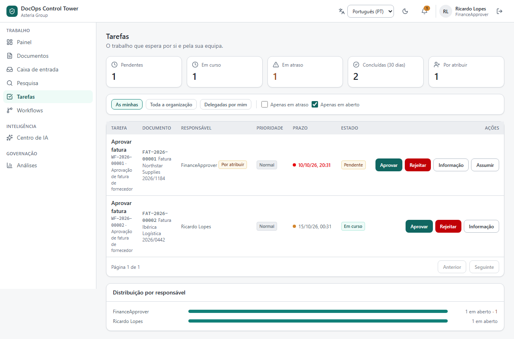
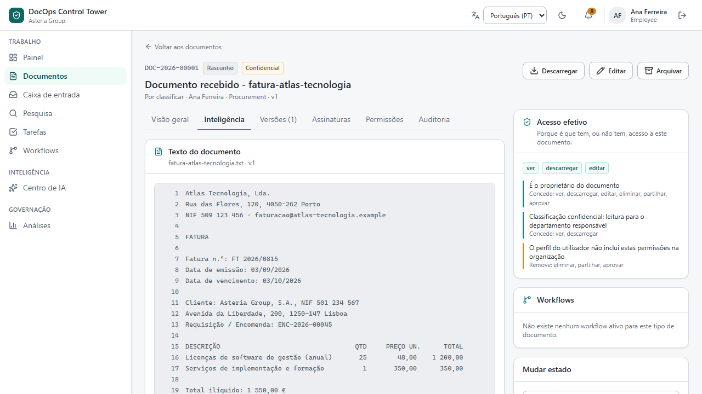
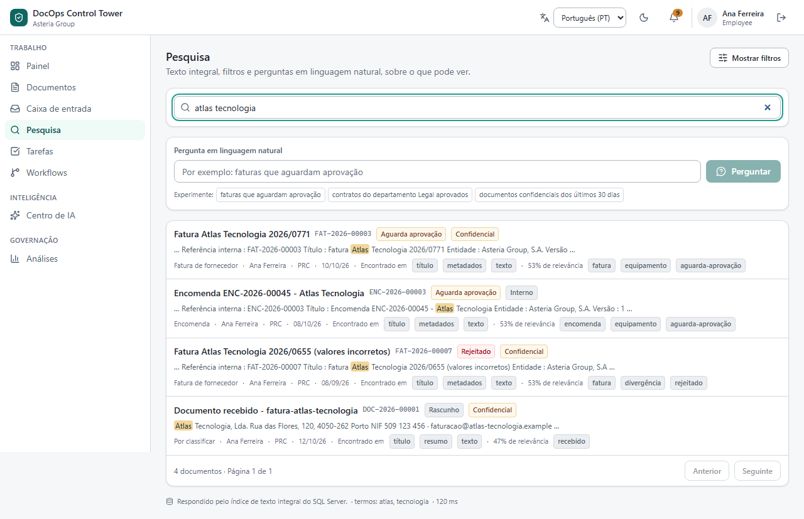
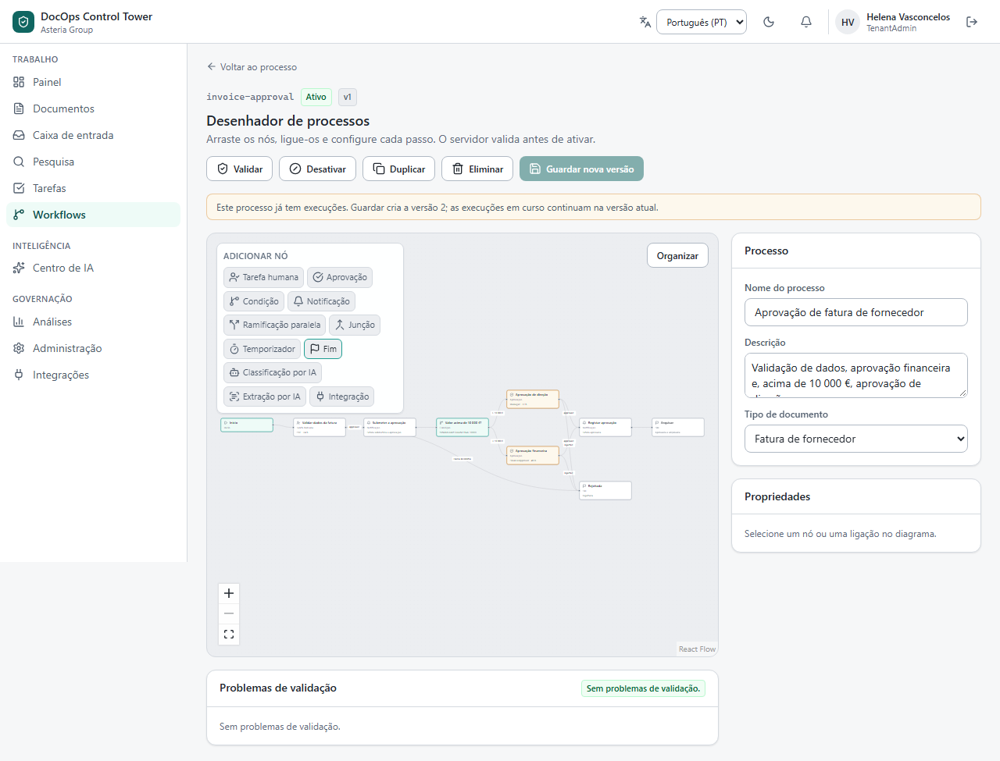

# DocOps Control Tower

DocOps is a document operations platform for organisations whose documents start business
processes: supplier invoices, contracts, purchase orders, employee records. Each document is kept
with its type, metadata, versions and permissions, goes through approval workflows with tasks and
deadlines, can be classified and read by an AI step whose suggestions a person must confirm, and
leaves an audit trail the application cannot change.

It is multi-tenant. Each organisation's data is separated twice: by the application, and by SQL
Server row-level security that denies access by default, so a connection that does not declare an
organisation sees no rows. This is a personal portfolio project with no link to any commercial
product, and every organisation, person and document in the demo is fictional.



## Run it

```bash
cp .env.example .env
docker compose -f docker-compose.full.yml up --build
```

Open http://localhost:8080 and sign in as `admin@asteria.example` with `Demo!Pass123`. The stack
starts SQL Server, creates the three database identities, runs the migrations and seeds the demo
catalogue, and only then starts the API, the worker and the web front end. The other demo accounts
and a guided walkthrough are in [docs/DEMO.md](docs/DEMO.md).

To work on the code with the API and Vite running on the host, follow [docs/SETUP.md](docs/SETUP.md).
It needs the .NET 10 SDK, Node 24 and Docker.

## What's in it

- **Documents.** Configurable types with typed metadata, versions with a SHA-256 digest,
  per-document permissions, retention policies and optimistic concurrency. An effective-access
  panel shows which rule grants or limits each right, computed by the same code that enforces it.
- **Workflows.** An engine of its own and a visual designer: approvals, conditions, parallel
  branches and joins, timers, and AI, integration and signature steps. A process that has already
  run is versioned instead of edited. Tasks have deadlines, escalation and group assignment.
- **Document intelligence.** Classification, field extraction and questions about a document, with
  citations checked against the text on the server. The default provider is deterministic and
  labelled as a demo on every screen; an OpenAI-compatible adapter is optional. Nothing reaches a
  document without a person's decision.
- **Search.** SQL Server full-text search with facets, inside the authorisation predicate. A
  question in plain language is turned into the same filters the form produces.
- **Around the repository.** A mail inbox, six integration adapters (three with a simulated far end,
  labelled as such), a supplier portal, an electronic signature flow without legal validity, reports
  computed by query, and administration of users, types, tags and retention.
- **Security.** Cookie sessions, permission-based authorisation on the server, tenant isolation in
  EF Core and in SQL Server, an immutable audit trail, client addresses read safely behind nginx,
  and webhook destinations checked when the server connects.
- **Interface.** Portuguese and English, light and dark themes, keyboard navigation, checked with
  axe-core at desktop and mobile widths.

| A document and why the user can reach it | Full-text search | Process designer |
| --- | --- | --- |
|  |  |  |

The screenshots show the Portuguese interface, which is the default; English is one click away.

The full list, screen by screen, is in [docs/FEATURES.md](docs/FEATURES.md).

## Design decisions

| Decision | Alternative considered | Why |
| --- | --- | --- |
| Modular monolith | Microservices | Documents, workflows, tasks and audit change together in one transaction. Splitting them would add eventual consistency and operating cost with no gain at this size ([ADR-001](docs/adr/ADR-001-modular-monolith.md)) |
| Row-level security that denies by default, with three database identities | Rely on EF Core query filters and document the gap | A connection that names no organisation sees zero rows, and system work needs both a session flag and the `app_system` login ([ADR-011](docs/adr/ADR-011-row-level-security-deny-by-default.md)) |
| Session cookie (`HttpOnly`, `SameSite=Lax`) with `Origin` checks | Bearer tokens held by the client | No token is readable by JavaScript, so an XSS bug cannot steal a session ([ADR-002](docs/adr/ADR-002-authentication.md)) |
| Own workflow engine | Elsa, a BPMN engine, Windows Workflow | Their own persistence and identity would sit outside the tenant isolation and the audit trail ([ADR-006](docs/adr/ADR-006-workflow-engine.md)) |
| Conditions as one operator from a closed set on a named variable | An expression language | Enough for the rules a business user draws, and stored data can never become code |
| Metadata as rows with a column per value type | A column per field, or JSON only | Each organisation defines its own fields, and filters and sorting still run in SQL |
| Reports computed on each request | Aggregate tables kept by a background job | A dashboard can never disagree with the list next to it; the cost was measured with 5,000 documents ([ADR-010](docs/adr/ADR-010-analytics-from-queries.md)) |
| Audit written in its own database context | In the same transaction as the operation | A refused or failed attempt is still recorded after the operation rolls back |

All the trade-offs are listed in [docs/ARCHITECTURE.md](docs/ARCHITECTURE.md#136-compromissos-assumidos).

## Tests

| Level | Tools | Count | What it covers |
| --- | --- | --- | --- |
| Unit | xUnit | 380 | Access evaluation, document lifecycle, workflow validation, tenant filter coverage, AI citations, webhook address rules |
| Integration | xUnit, Testcontainers | 227 | The HTTP API against a real SQL Server, connected with the same three identities as the application |
| Component | Vitest, Testing Library | 67 | HTTP client and error contract, sign-in, designer graph, AI suggestions |
| End-to-end | Playwright, axe-core | 104 × 2 | Real browser journeys, each run at desktop and at mobile size, including accessibility checks |

Every level runs in CI on each push. Two convention tests check things a reviewer would miss: one
fails if any tenant-scoped entity lacks a query filter, the other fails if a test asserts a total
from a list that other tests also fill.

## How I built this

I wrote the specification for DocOps and built it in phases over September and October 2026, using
AI coding assistants for some of the implementation. My part was the design and the review: deciding
that tenant isolation had to be enforced in SQL Server itself and not only in the application, the
workflow engine's semantics, the test strategy, and reading, questioning and correcting what was
generated. Several of the bugs recorded in the commit history were found by asking for independent
code reviews and by writing integration tests against a real SQL Server: the parallel join that
waited forever came from a review, the webhook query that never reached SQL from a test. The ADRs
document the decisions and the alternatives I rejected.

## Known limitations

- **The demo AI is not a language model.** The default provider is rule-based and says so on every
  screen. The OpenAI-compatible adapter exists but has not been run against a real service.
- **Citation checks have two limits.** Any citation whose words are not on the cited line is
  dropped; for a model, the value must also be readable from those words, but the demo provider is
  not held to that. A dropped citation disappears instead of being shown as unverified.
- **The electronic signature has no legal validity.** It shows the request, signing and record flow
  ([ADR-009](docs/adr/ADR-009-electronic-signature.md)).
- **Connectors simulate the far end.** The mail and integration adapters are real code; the
  external systems behind them are not connected.
- **It isolates organisations but does not run them.** Sign-in asks only for e-mail and password,
  an e-mail is unique across the installation, organisations are not created through the
  application, and each person belongs to one.
- **No federated sign-in (OIDC) and no multi-factor authentication.**
- **Files are stored on local disk.** Storage sits behind `IFileStorage`, but only the disk
  implementation exists.
- **The audit trail holds personal data** such as the name and e-mail of whoever acted. The
  application cannot change it, but a database administrator can.
- **Scale was measured with about 5,000 documents.** Paging is by offset and counts have no cap.
- **A database administrator can switch row-level security off.** That is closed by not handing out
  that login ([docs/SECURITY.md](docs/SECURITY.md)).

## Documentation

- [Architecture](docs/ARCHITECTURE.md) and the [decision records](docs/adr/)
- [Security model](docs/SECURITY.md)
- [Features in detail](docs/FEATURES.md)
- [Setup](docs/SETUP.md) and [demo walkthrough](docs/DEMO.md)
- [Product vision](docs/VISION.md)

The documents in `docs/` are written in Portuguese.

If you'd like to know more about this project, reach out on [LinkedIn](https://www.linkedin.com/in/alexandre-magno-382a813b2/).

---

© 2026 Alexandre Magno. All rights reserved.
