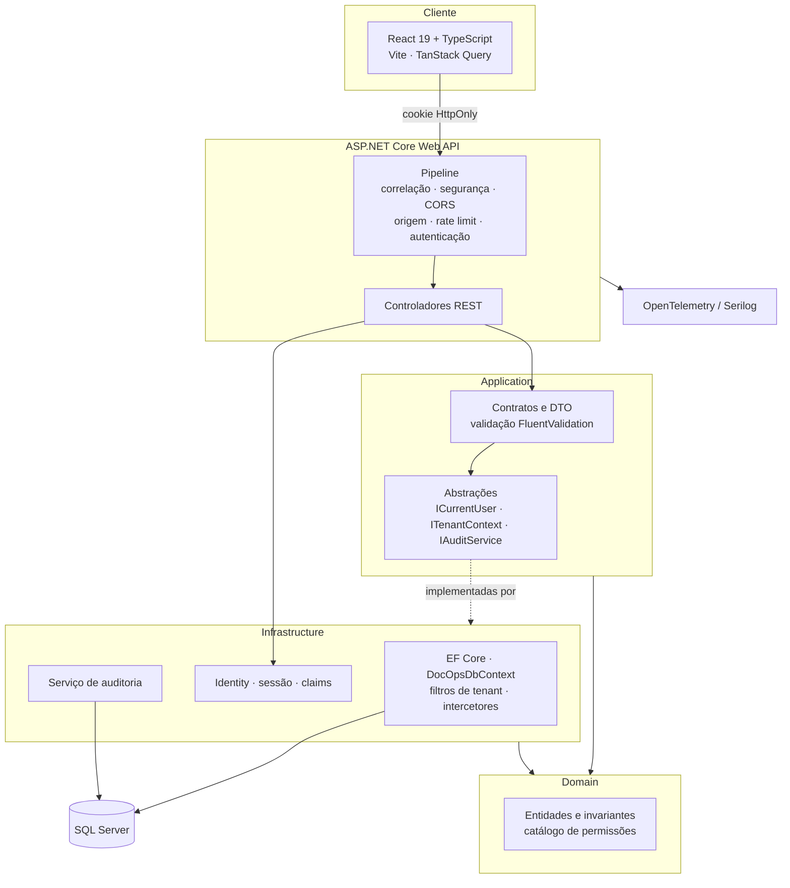
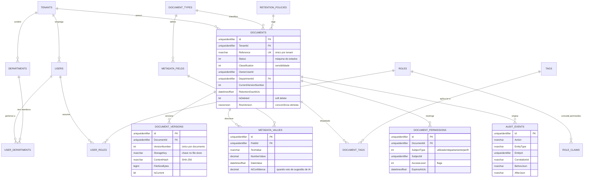
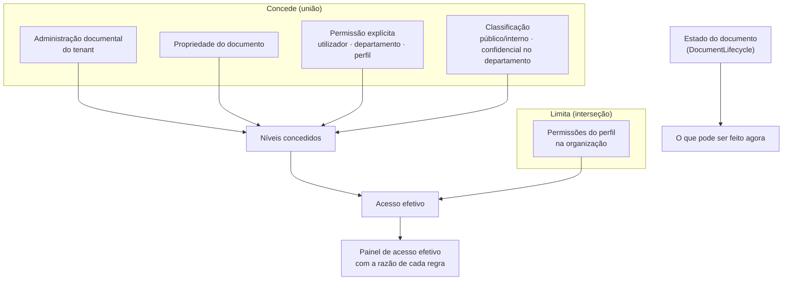
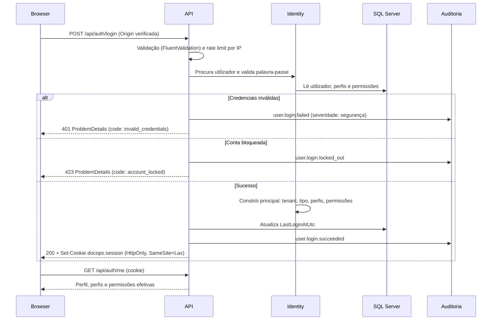
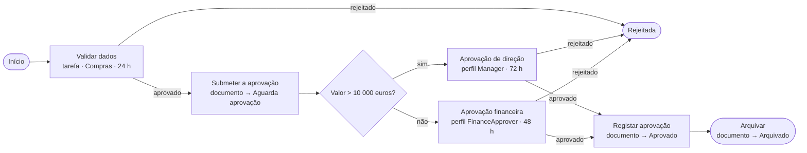

# DocOps Control Tower

**Transforme documentos em processos de negócio controlados e auditáveis.**

Plataforma de operações documentais que combina repositório documental governado, automação de
workflows, processamento assistido por IA, pesquisa segura e trilho de auditoria completo.

> **Projeto de portefólio independente.** Demonstração técnica pessoal, sem afiliação, associação ou
> relação com qualquer produto ou fornecedor comercial. Todas as organizações, pessoas e documentos
> usados na demonstração são fictícios.

---

## 1. Visão do produto

Nas organizações, os documentos que importam, como faturas de fornecedor, contratos, encomendas e
processos de colaboradores, não são ficheiros: são o início de processos de negócio com
responsáveis, prazos, decisões e obrigações de conformidade. O DocOps Control Tower trata o
documento como aquilo que ele é, ligando repositório, metadados, circuito de aprovação, decisão e
prova.

## 2. Problema que resolve

| Problema operacional | Resposta da plataforma |
| --- | --- |
| Documentos dispersos por e-mail e pastas partilhadas | Repositório único com metadados, tipos e versões |
| Aprovações informais e sem rasto | Motor de workflow com tarefas, prazos e escalonamento |
| Introdução manual de dados de faturas e contratos | Classificação e extração assistida por IA com validação humana |
| "Quem viu, alterou ou aprovou isto?" | Registo de auditoria imutável e pesquisável |
| Acessos concedidos sem critério | Autorização por permissão, departamento e documento, validada no servidor |
| Retenção e obrigações legais geridas em folhas de cálculo | Políticas de retenção, classificação de sensibilidade e retenção legal |

## 3. Começar

As palavras-passe locais vivem num ficheiro `.env`, fora do Git, que se cria uma vez a partir do
exemplo. Os valores de exemplo funcionam como estão; trocá-los é opcional numa máquina local.

```bash
cp .env.example .env
```

**Ver o produto a funcionar, sem instalar .NET nem Node:**

```bash
docker compose -f docker-compose.full.yml up --build   # → http://localhost:8080
```

Entrar com `admin@asteria.example` e `Demo!Pass123`. A base de dados, as migrações, o catálogo de
demonstração, a API, o worker e a interface sobem num comando, pela ordem certa: a base fica
saudável, as três identidades de base de dados são criadas, o passo de migração corre até ao fim,
e só então a aplicação arranca.

**Desenvolver:**

```bash
docker compose up -d                                  # SQL Server
```

Na primeira vez, com a base ainda vazia, criar a base de dados e as três identidades com que a
aplicação se liga, lendo as palavras-passe do `.env` (detalhe em
[`docs/SETUP.md`](docs/SETUP.md), secção 3.1):

```bash
docker cp scripts/create-database-identities.sql docops-sqlserver:/tmp/
docker exec --env-file .env docops-sqlserver bash -c '/opt/mssql-tools18/bin/sqlcmd -S localhost -U sa -P $MSSQL_SA_PASSWORD -C -b -v AppTenantPassword=$DOCOPS_TENANT_PASSWORD AppSystemPassword=$DOCOPS_SYSTEM_PASSWORD MigratorPassword=$DOCOPS_MIGRATOR_PASSWORD -i /tmp/create-database-identities.sql'
```

Depois, cada um no seu terminal:

```bash
dotnet run --project src/Api/DocOps.Api.csproj        # API    → http://localhost:5180
npm --prefix src/Web install                          # só na primeira vez
npm --prefix src/Web run dev                          # Web    → http://localhost:5173
dotnet run --project src/Worker/DocOps.Worker.csproj  # Worker (opcional: prazos e temporizadores)
```

Pré-requisitos, comandos e credenciais: [`docs/SETUP.md`](docs/SETUP.md).
Guião da demonstração: [`docs/DEMO.md`](docs/DEMO.md).
Arquitetura e decisões: [`docs/ARCHITECTURE.md`](docs/ARCHITECTURE.md) e [`docs/adr/`](docs/adr/).
Modelo de segurança: [`docs/SECURITY.md`](docs/SECURITY.md).

## 4. Estado

O âmbito planeado está concluído, e cada funcionalidade foi entregue a funcionar de ponta a ponta:
base de dados, API, interface e testes. Não existem ecrãs de demonstração estáticos: tudo o que a
interface mostra vem da base de dados através da API.

São mais de 800 testes automatizados, em quatro níveis descritos na
[secção 16](#16-estratégia-de-testes). O que o produto não faz, e porquê, está na
[secção 19](#19-limitações-conhecidas-e-melhorias-futuras).

## 5. Arquitetura



**Porquê um monólito modular:** o domínio é altamente transacional e fortemente relacionado
(documento → workflow → tarefa → auditoria). Microserviços introduziriam consistência eventual e
custo operacional sem benefício correspondente nesta escala. As fronteiras entre módulos são
explícitas no código, o que mantém aberta a opção de extrair um módulo mais tarde.
Ver [ADR-001](docs/adr/ADR-001-modular-monolith.md).

Documentação detalhada: [`docs/ARCHITECTURE.md`](docs/ARCHITECTURE.md).

## 6. Stack tecnológica

| Camada | Tecnologia |
| --- | --- |
| Backend | .NET 10, C# 14, ASP.NET Core Web API, EF Core 10 |
| Base de dados | SQL Server 2022 (container) |
| Identidade | ASP.NET Core Identity, cookies `HttpOnly`, autorização por permissões |
| Validação | FluentValidation |
| Observabilidade | Serilog, OpenTelemetry, health checks |
| Frontend | React 19, TypeScript, Vite, TanStack Query, React Hook Form, Zod, Tailwind CSS 4, i18next |
| Testes | xUnit, Testcontainers, Vitest, Testing Library, Playwright |
| Infraestrutura | Docker Compose, GitHub Actions |

## 7. Modelo de segurança

- **A interface nunca é fonte de verdade.** Todas as decisões de autorização são tomadas no servidor;
  o frontend apenas esconde o que o utilizador não pode usar.
- **Tenant nunca vem do cliente.** O identificador da organização é lido exclusivamente das *claims*
  do cookie de sessão. Não existe rota, cabeçalho ou campo que o aceite.
- **Isolamento na aplicação e no motor.** Filtros globais de consulta impedem leituras cruzadas e
  o `TenantGuardInterceptor` recusa escritas cruzadas; por baixo, uma política de segurança ao nível
  da linha do SQL Server **nega por omissão**, de forma que uma ligação que não declara organização
  não vê linha nenhuma. Vale para quem se liga por fora, e vale para `sa`.
- **Três identidades de base de dados.** `app_tenant` atende pedidos, `app_system` é o nome que a
  política aceita para dispensa, e `docops_migrator` é o único que altera o esquema. A dispensa não é
  uma chave que se escreva: é uma chave **mais** a identidade certa.
- **Permissões, não perfis.** Os *endpoints* exigem permissões (`documents.approve`), guardadas como
  *claims* de perfil na base de dados e editáveis sem novo *deploy*.
- **Sessão em cookie `HttpOnly`, `SameSite=Lax`.** Nenhum token é acessível a JavaScript. CSRF é
  mitigado pelo `SameSite` e por validação de `Origin`/`Referer` em todos os métodos que alteram estado.
- **Auditoria imutável.** A aplicação recusa alterar ou apagar registos de auditoria; a base de dados
  revoga `UPDATE`/`DELETE` aos utilizadores da aplicação.

Detalhe completo: [`docs/SECURITY.md`](docs/SECURITY.md).

## 8. Desenho da base de dados



Decisões de modelação relevantes:

- **Identificadores UUIDv7** (`Guid.CreateVersion7()`): únicos e sequenciais, evitando a fragmentação
  de índice típica de GUIDs aleatórios. As chaves são geradas pela aplicação e o modelo declara-o
  (`ValueGeneratedNever`). Sem isso, o EF Core interpreta "a chave já tem valor" como "esta linha já
  existe" e emite `UPDATE` onde era preciso `INSERT`.
- **`rowversion` como token de concorrência** nas entidades mutáveis, devolvido ao cliente e exigido
  na gravação.
- **Índices únicos filtrados** (referência do documento, código de departamento, etiqueta) que
  ignoram registos eliminados, permitindo reutilizar um código após eliminação.
- **Metadados tipados**: o valor é guardado como texto canónico *e* na coluna do seu tipo, para que
  filtros e ordenações corram em SQL em vez de em memória.
- **Conteúdo fora da base de dados**: a linha da versão guarda a chave de armazenamento, a dimensão e
  o `SHA-256`; os bytes vivem no *file store* (ver [ADR-003](docs/adr/ADR-003-document-storage.md)).
- **Ator desnormalizado na auditoria**, para o trilho continuar legível depois de um utilizador mudar
  de nome ou ser desativado.

### Autorização documental



O acesso responde a *quem pode agir*; o ciclo de vida responde a *o que pode ser feito agora*. São
deliberadamente independentes: misturá-los tornava impossível arquivar um documento aprovado.

## 9. Fluxo de autenticação



## 10. Superfície da API

Documentada em OpenAPI (`/openapi/v1.json`), navegável em `/scalar/v1` durante o desenvolvimento.

| Método e rota | Descrição |
| --- | --- |
| `POST /api/auth/login` · `POST /api/auth/logout` · `GET /api/auth/me` | Sessão e perfil do chamador |
| `GET /api/tenants/current` · `GET /api/tenants/current/departments` | Organização do chamador |
| `GET /api/documents` | Lista paginada e filtrada, limitada ao que o chamador pode ver |
| `POST /api/documents` | Cria um documento a partir de um ficheiro (multipart) |
| `GET /api/documents/{id}` | Detalhe, versões, metadados e acesso efetivo |
| `PUT /api/documents/{id}` | Edita metadados (exige o token de concorrência) |
| `POST /api/documents/{id}/versions` | Acrescenta uma versão |
| `GET /api/documents/{id}/content` | Descarrega a versão atual ou uma específica |
| `POST /api/documents/{id}/status` | Transição de estado validada pela máquina de estados |
| `POST /api/documents/{id}/archive` · `/restore` · `DELETE /api/documents/{id}` | Arquivo, restauro e eliminação reversível |
| `GET /api/documents/{id}/audit` | Trilho de auditoria do documento |
| `GET /api/workflows` · `/{id}` | Definições de workflow e o seu grafo |
| `POST /api/workflows` | Cria um processo em rascunho, já com início e fim ligados |
| `PUT /api/workflows/{id}` | Guarda o grafo desenhado (edita no sítio ou cria nova versão) |
| `POST /api/workflows/{id}/duplicate` · `DELETE /api/workflows/{id}` | Duplicação e eliminação reversível |
| `POST /api/workflows/{id}/test` | Valida uma definição sem a executar |
| `POST /api/workflows/{id}/activate` · `/deactivate` | Ativação (recusada se houver erros de validação) |
| `GET /api/workflows/instances` · `/{id}` | Execuções, com cronologia, tarefas e variáveis |
| `POST /api/workflows/instances` | Inicia um processo sobre um documento |
| `POST /api/workflows/instances/{id}/cancel` | Cancela um processo e fecha as tarefas em aberto |
| `GET /api/tasks` · `/statistics` | Centro de tarefas e indicadores |
| `POST /api/tasks/{id}/approve` · `/reject` · `/complete` · `/request-information` | Decisões sobre uma tarefa |
| `POST /api/tasks/{id}/claim` · `/reassign` | Assumir e reatribuir |
| `GET /api/notifications` · `/unread-count` | Notificações do utilizador |
| `GET/POST/DELETE /api/documents/{id}/permissions` | Permissões do documento |
| `GET /api/documents/{id}/effective-access` | Acesso efetivo, com a razão de cada regra |
| `GET /api/document-catalogue/types` · `/tags` · `/retention-policies` | Dados de referência dos formulários |
| `GET /api/documents/{id}/text` | Texto da versão atual, numerado como as citações o numeram |
| `POST /api/documents/{id}/process-ai` | Analisa o documento e produz sugestões para revisão |
| `GET /api/documents/{id}/ai-runs/latest` | A análise mais recente de um documento |
| `GET /api/ai/provider` · `/statistics` · `/runs` | Fornecedor ativo, indicadores e fila de revisão |
| `POST /api/ai/runs/{id}/classification` · `/fields/{id}/decision` · `/accept-all` | Decisões sobre as sugestões |
| `POST /api/ai/runs/{id}/apply` · `/discard` | Aplicar ao documento ou rejeitar a análise |
| `POST /api/ai/document-question` | Pergunta sobre um documento, com citações verificadas |
| `GET /api/search` | Pesquisa facetada, com excerto e relevância; diz se usou o índice de texto integral |
| `POST /api/search/natural-language` | Lê uma pergunta para os mesmos filtros do formulário |
| `GET /api/inbox` · `/summary` · `/connector` · `/{id}` | Caixa de entrada, contagens, origem do correio e leitura de uma mensagem |
| `POST /api/inbox/sync` | Sincroniza pelo conetor de correio (idempotente) |
| `POST /api/inbox/{id}/read` · `/archive` · `/reopen` · `/processed` | Estado de uma mensagem |
| `POST /api/inbox/{id}/attachments/save` · `/document` · `/link` · `/workflow` | Anexo como documento, documento a partir da mensagem, associação e início de processo |
| `GET /api/integrations` · `/{id}` · `/{id}/log` | Cartões das integrações e o registo de cada uma |
| `POST /api/integrations/{id}/run` | Executa uma integração agora (exige `integrations.manage`) |
| `PUT /api/integrations/{id}` | Ativa, desativa e configura (destino do webhook validado no servidor) |
| `GET /api/portal/submissions` · `/{id}` | O que este parceiro submeteu, e o estado de cada submissão |
| `POST /api/portal/submissions` | Submete um documento (multipart); exige `portal.submit` |
| `POST /api/portal/submissions/{id}/information` | Responde a um pedido de informação em aberto |
| `GET /api/portal/submissions/{id}/content` | Descarrega o ficheiro que o próprio parceiro enviou |
| `GET /api/documents/{id}/signatures` · `POST` | Pedidos de assinatura de um documento, e criar um |
| `GET /api/signatures/mine` | O que aguarda a assinatura de quem pergunta |
| `POST /api/signatures/{id}/sign` · `/decline` · `/cancel` | Assinar, recusar com motivo, retirar o pedido |
| `GET /api/reports/dashboard` | Indicadores, tendências, distribuições e estrangulamentos do período pedido, limitados ao que o chamador pode ver |
| `GET /api/reports/export` | O mesmo conjunto em CSV; exige `reports.export` |
| `GET /api/admin/users` | Contas da organização do chamador (`includeInactive` traz as desativadas) |
| `POST /api/admin/users` | Cria uma conta e devolve a palavra-passe inicial, uma única vez |
| `PUT /api/admin/users/{id}` | Nome, função, perfis e departamentos; recusa a própria conta e `SystemAdmin` |
| `POST /api/admin/users/{id}/active` | Desativa ou reativa; nunca elimina |
| `GET /api/admin/roles` | Perfis atribuíveis e o que cada um concede |
| `GET /api/admin/departments` · `POST` · `PUT /{id}` | Departamentos da organização, com código único |
| `GET /api/admin/document-types` · `POST` · `PUT /{id}` | Tipos de documento da organização (`includeInactive` traz os desativados) |
| `POST /api/admin/document-types/{id}/active` | Desativa ou reativa; o tipo de entrada é recusado |
| `GET /api/admin/document-types/{id}/fields` · `POST` · `PUT /{fieldId}` · `DELETE /{fieldId}` | Esquema de metadados do tipo; eliminar é recusado se algum documento preencher o campo |
| `GET /api/admin/retention-policies` | As políticas que um tipo pode adotar por omissão |
| `GET /api/admin/tags` · `POST` · `PUT /{id}` | Etiquetas da organização (`includeDeleted` traz as removidas) |
| `DELETE /api/admin/tags/{id}` · `POST /{id}/restore` | Remove de circulação e repõe: as ligações aos documentos sobrevivem |
| `POST /api/admin/retention-policies` · `PUT /{id}` | Políticas de retenção; exige `admin.settings` |
| `POST /api/admin/retention-policies/{id}/active` | Retirar é recusado enquanto um tipo a adotar |
| `GET /api/tenants/current/roles` | Os perfis a quem um documento pode ser concedido |
| `GET /api/documents/{id}/effective-access` | Porque é que o chamador alcança o documento, ou, para quem pode partilhar, porque é que outra pessoa o alcança |
| `GET /api/system/health` | Estado do trabalho em segundo plano e do trabalho à espera; exige `admin.settings` |
| `GET /health` · `/health/live` · `/health/ready` | Sondas anónimas: nome, estado e duração, e nada mais |

## 11. Motor de workflow



O motor percorre a definição de nó em nó até cada ramo ficar **parado** (alguém tem de agir, ou um
temporizador tem de decorrer) ou **terminado**, e só então grava. Uma travessia é uma transação: a
instância, as suas tarefas, a cronologia e a alteração de estado do documento ficam consistentes
entre si, e uma falha a meio deixa a instância exatamente onde estava.

Princípios que valem a pena destacar:

- **O motor não contorna as regras do documento.** Uma alteração de estado configurada num nó passa
  pela máquina de estados do documento; se a transição for ilegal, a instância para com o motivo
  registado em vez de forçar um estado inválido.
- **Tipos de nó sem executor falham de forma explícita.** Um processo desenhado com um nó de IA não
  pode sequer ser ativado, porque a validação o recusa, e, se lá chegasse, pararia com a razão visível na
  cronologia em vez de saltar o passo.
- **As condições não são uma linguagem de expressões**, mas um operador de um conjunto fechado sobre
  uma variável nomeada: suficiente para as regras que um utilizador de negócio desenha, e impossível
  de transformar num meio de executar código a partir de dados guardados.
- **Trabalho de grupo é trabalho reclamável.** Uma tarefa oferecida a um departamento ou perfil fica
  por atribuir até alguém agir sobre ela; nesse momento fica registada a quem pertence a decisão.

Desenho e alternativas ponderadas: [ADR-006](docs/adr/ADR-006-workflow-engine.md).

## 12. Processamento em segundo plano

O projeto `src/Worker` é um processo separado da API. Corre, num intervalo configurável:

- **Retoma de temporizadores**: instâncias paradas num nó de espera cuja data chegou. Enquanto
  esperam não custam nada: nem uma linha de execução, nem uma ligação, apenas uma data numa coluna.
- **Escalonamento de prazos**: tarefas em aberto que passaram a data limite são escaladas uma única
  vez, notificando o responsável do departamento (ou quem iniciou o processo), com entrada na
  cronologia e registo de auditoria.

Corre sem organização no contexto ambiente, o que é precisamente o que lhe permite ver todas as
organizações. É uma exceção deliberada e confinada: nada disto é alcançável a partir de um pedido HTTP.

## 13. Arquitetura de IA

A aplicação depende de abstrações (`IAiDocumentService`, `IAiSearchService`, `IAiWorkflowService`) e
nunca de um fornecedor concreto. O fornecedor de demonstração é determinístico e identificado como
tal na interface, e as respostas de demonstração nunca são apresentadas como geradas por um modelo real.
Ver [ADR-004](docs/adr/ADR-004-ai-provider-abstraction.md).

## 13.1 Pesquisa

`ISearchService` corre filtros, texto e ordenação numa única consulta, dentro do predicado de
autorização. `IAiSearchService` lê perguntas em linguagem natural e devolve **filtros**, nunca
resultados: a execução, e portanto a autorização, é sempre do `ISearchService`.

O texto integral depende de um componente opcional do SQL Server: a imagem em
`docker/sql-server/Dockerfile` instala-o, a migração que cria os índices está protegida por
`SERVERPROPERTY('IsFullTextInstalled')`, e a pesquisa deteta o que o servidor sabe fazer e declara-o
em cada resposta. Ver [ADR-005](docs/adr/ADR-005-search-architecture.md).

## 13.2 Caixa de entrada

`IMailConnector` é a única porta por onde entra correio, com a forma que o Microsoft Graph tem
(listar mensagens de uma caixa, buscar o conteúdo de um anexo por identificador). `DemoMailConnector`
serve um catálogo fixo de correspondência realista sem rede nem credenciais, e declara-se como
demonstração em cada mensagem que devolve.

O que a caixa de entrada produz, documentos e processos, é produzido pelos serviços que já existem,
nunca por escrita direta. Ver [ADR-007](docs/adr/ADR-007-external-connectors.md).

## 14. Estratégia de integrações

Cada sistema externo é representado por um **adaptador atrás de uma interface** (`IIntegrationAdapter`,
e `IMailConnector` para o correio), com registo de execuções e erros por organização. O
desenvolvimento local **nunca exige credenciais de terceiros**: nenhum adaptador as pede, e nenhuma
é guardada: as definições de uma integração são explicitamente não secretas.

Seis adaptadores estão escritos: Microsoft Outlook, ERP, CRM, assinatura eletrónica, webhooks e
importação de ficheiros. Três deles têm o lado de lá simulado (o ERP e o CRM reconciliam contra
listas locais fixas, o Outlook corre sobre o conetor de demonstração) e **dizem-no no cartão**; os
outros três fazem trabalho verdadeiro de ponta a ponta e por isso não se rotulam de demonstração.

Quem escreve o estado e os contadores de uma integração é o executor, a partir do resultado que o
adaptador devolveu, e nunca o próprio adaptador, para que o cartão seja o registo do que aconteceu e
não a opinião do adaptador sobre si mesmo. Ver [ADR-007](docs/adr/ADR-007-external-connectors.md).

## 15. Observabilidade

- **Logs estruturados** (Serilog) com `CorrelationId`, `UserId` e propriedades de pedido.
- **Correlação ponta a ponta**: o mesmo identificador aparece no cabeçalho `X-Correlation-Id` da
  resposta, nos logs, no *trace* e em cada registo de auditoria do pedido.
- **OpenTelemetry** para *traces* e métricas de ASP.NET Core e HttpClient; exportação OTLP ativada
  apenas quando existe *endpoint* configurado.
- **Health checks**: `/health/live` (processo vivo), `/health/ready` (dependências prontas),
  `/health` (visão completa), sem revelar detalhe de infraestrutura.

## 16. Estratégia de testes

| Nível | Ferramenta | O que garante |
| --- | --- | --- |
| Unitário | xUnit | Avaliação de acesso e de permissões, ciclo de vida do documento, catálogo de perfis, avaliador de condições e validador de definições do motor, cobertura dos filtros por organização, extração de valores e citações da IA, vocabulário de pesquisa, paginação e validação |
| Integração | xUnit + Testcontainers (SQL Server real) | Autenticação, documentos, isolamento entre organizações, segurança ao nível da linha, imutabilidade da auditoria, motor e desenho de workflow, inteligência documental, pesquisa, caixa de entrada, integrações, exclusão mútua do worker e custo do painel com milhares de documentos |
| Componente | Vitest + Testing Library | Cliente HTTP e contrato de erros, página de início de sessão, grafo do desenhador, apresentação de sugestões da IA, definições das integrações |
| End-to-end | Playwright (desktop e móvel) | Percursos reais no browser: sessão em cookie `HttpOnly`, documentos, tarefas, desenhador, IA, pesquisa, caixa de entrada, integrações, portal, troca de idioma, largura de cada ecrã e acessibilidade com axe-core |

Os testes de integração correm contra SQL Server em container, com as mesmas migrações da aplicação:
não há base de dados em memória a mascarar comportamento relacional. Ligam-se com as mesmas três
identidades de base de dados que a aplicação usa, porque com uma ligação de administrador os testes
de isolamento passariam com ou sem a política de segurança ligada.

## 17. Estratégia de implantação

Para desenvolvimento, `docker compose up` levanta só a base de dados, e a API aplica as migrações e
semeia os dados de demonstração no arranque.

`docker compose -f docker-compose.full.yml up --build` levanta a pilha inteira, pela ordem certa: a
base de dados, um passo que cria as três identidades de base de dados, um passo de migração que corre
uma vez e termina, e só então a API, o worker e a interface servida por nginx. A migração é um passo
à parte porque duas instâncias a arrancar ao mesmo tempo correriam as migrações em paralelo, e porque
assim a aplicação não precisa de poder alterar o esquema. Detalhe em
[`docs/ARCHITECTURE.md`](docs/ARCHITECTURE.md).

As abstrações de armazenamento, IA e identidade permitem mover para Azure Blob Storage, Azure SQL,
Azure OpenAI e Microsoft Entra ID sem alterar o código de domínio, e nada disso é necessário para
correr o projeto localmente.

## 18. Compromissos assumidos

| Decisão | Alternativa ponderada | Porque assim |
| --- | --- | --- |
| Monólito modular | Microserviços | Domínio transacional e coeso; evita consistência eventual desnecessária |
| Um tenant por utilizador | Adesão N:N a organizações | Simplifica cada consulta e o início de sessão; administradores de plataforma cobrem o caso excecional |
| Permissões em *claims* de perfil | Tabela de permissões própria | Reutiliza a infraestrutura do Identity; permissões editáveis sem novo *deploy* |
| `IdentityUser` no domínio | Entidade de domínio separada do utilizador de autenticação | Evita duplicação de modelos e sincronização entre eles; ver [ADR-002](docs/adr/ADR-002-authentication.md) |
| Cookies em vez de JWT | *Bearer tokens* no cliente | Sem token acessível a JavaScript; XSS não permite roubo de sessão |
| Validação de `Origin` | *Tokens* antifalsificação | Protege toda a API sem estado adicional no cliente; `SameSite=Lax` cobre o resto |
| Sem MediatR/CQRS | Pipeline de comandos e consultas | Custo de indireção não justificado nesta dimensão |
| Conteúdo fora da base de dados | `varbinary(max)` ou `FILESTREAM` | Base pequena e rápida; mesmo código em disco local e em armazenamento de objetos |
| Acesso separado do ciclo de vida | Um único cálculo de "pode editar" | Misturá-los tornava impossível arquivar um documento aprovado |
| Metadados em EAV com colunas tipadas | Coluna por campo, ou só JSON | Esquema configurável pelo cliente sem perder filtros e ordenações em SQL |
| Motor de workflow próprio | Elsa, BPMN, WF | Persistência e identidade próprias colidiriam com o isolamento e a auditoria; ver [ADR-006](docs/adr/ADR-006-workflow-engine.md) |
| Condições como operador sobre variável | Linguagem de expressões | Suficiente para regras de negócio, e sem superfície para executar código a partir de dados |
| Worker em processo separado | Trabalho em segundo plano dentro da API | Trabalho periódico e lento não partilha recursos com pedidos de utilizadores |
| Indicadores calculados no momento | Tabela de agregados mantida por um processo à parte, ou cache | Paga-se latência para nunca haver um painel que discorda da lista ao lado; ver [ADR-010](docs/adr/ADR-010-analytics-from-queries.md) |
| Medida sem base devolve `null` | Devolver zero, como quase todos os painéis | Zero afirma que se mediu; num período sem nada para medir é uma mentira com aspeto de facto |
| Negar por omissão no motor, com três identidades | Confiar nos filtros do EF Core e documentar a limitação | Uma ligação que não declara organização vê zero linhas, e a dispensa exige a identidade `app_system`; ver [ADR-011](docs/adr/ADR-011-row-level-security-deny-by-default.md) |
| Chaves geradas pela aplicação (UUIDv7) | Identidade gerada pela base de dados | A entidade tem identidade antes de ser gravada, o EF não confunde uma versão nova com uma existente, e por serem sequenciais não fragmentam os índices como um GUID aleatório |
| Auditoria escrita num contexto próprio | Na mesma transação da operação | O registo de uma tentativa recusada ou falhada sobrevive ao *rollback* da operação que descreve |
| O desenhador só oferece o que o motor executa | Paleta com todos os tipos de passo previstos | Um processo desenhado nunca falha ao executar por usar um passo que o motor ainda não sabe correr |

## 19. Limitações conhecidas e melhorias futuras

### O que o produto não faz

- **A IA de demonstração não é um modelo de linguagem.** O fornecedor por omissão é determinista,
  baseado em regras, e diz que é uma demonstração em todos os ecrãs onde aparece. O adaptador
  compatível com OpenAI existe, mas não foi exercitado contra um serviço real.
- **As citações da IA não são confirmadas pelo servidor.** O ecrã mostra cada uma ao lado do texto de
  origem, para quem revê a sugestão a confirmar; a verificação automática ainda não existe.
- **A assinatura eletrónica não tem validade legal.** Demonstra o fluxo de pedido, assinatura e
  registo; ver [ADR-009](docs/adr/ADR-009-electronic-signature.md).
- **Os conetores simulam o lado de lá.** Os adaptadores de correio e de integrações são reais, mas os
  serviços externos não estão ligados.
- **Isola várias organizações, mas não as opera.** O início de sessão pede só e-mail e palavra-passe,
  o e-mail é único em toda a instalação, e as organizações não se criam pela aplicação. Cada pessoa
  pertence a uma só.
- **Não há autenticação federada (OIDC) nem multifator.**
- **Os ficheiros ficam em disco local.** O armazenamento está atrás de `IFileStorage`, mas só existe
  a implementação em disco.
- **A auditoria guarda dados pessoais**, como o e-mail e o nome de quem agiu. É imutável para a
  aplicação, mas não é um registo criptograficamente inviolável: quem administra a base de dados pode
  alterá-la.
- **A escala foi medida com cerca de 5 000 documentos.** A paginação é por deslocamento e as
  contagens não têm teto, o que chega para esta dimensão e deixaria de chegar a uma ordem de grandeza
  acima.
- **Quem se liga à base de dados como administrador pode desligar a política de segurança ao nível da
  linha.** Fecha-se não dando essa credencial a ninguém; ver [`docs/SECURITY.md`](docs/SECURITY.md).

### Melhorias futuras

- Verificação, no servidor, de que cada citação da IA existe no texto de origem.
- Endereço ou campo de organização no início de sessão, criação de organizações pela aplicação, e
  adesão de uma pessoa a várias, com seletor de contexto auditado.
- OIDC com o padrão BFF, mantendo a sessão em cookie `HttpOnly`, e autenticação multifator.
- Adaptador de armazenamento de objetos, compatível com S3.
- Paginação por chave e contagens com teto, para catálogos de milhões de documentos.
- Auditoria sem dados pessoais nos registos, e exportação assinada criptograficamente.
- Conetores reais por trás dos adaptadores que hoje simulam o lado de lá (Microsoft Graph para o
  correio, APIs de ERP e CRM). A interface não muda, só a implementação registada.
- Extração do módulo de IA para processo próprio, caso o volume o justifique.
- Aplicação instalável (PWA) com trabalho offline para consulta documental.
- Idiomas adicionais (es, fr, ro), que a arquitetura de localização já suporta.

---

## 20. O que faz, em detalhe

As capacidades agrupadas pelo que são, e não pela ordem em que foram construídas. As decisões com
peso arquitetural, cada uma com as alternativas que ficaram de fora, estão nos [ADR](docs/adr/).

### Fundação, segurança e multi-organização

- Monólito modular .NET 10 com fronteiras explícitas (`Domain`, `Application`, `Infrastructure`, `Api`).
- Base de dados SQL Server modelada com EF Core: chaves estrangeiras, índices, índices únicos
  filtrados, tokens de concorrência, *soft delete* e carimbos temporais automáticos.
- Multi-tenancy com isolamento imposto em duas camadas (filtros globais de leitura + intercetor de
  escrita).
- Autenticação por cookie `HttpOnly` com ASP.NET Core Identity, bloqueio por tentativas e política
  de palavra-passe.
- Autorização por permissões (não por perfis) com permissões guardadas em base de dados e
  políticas geradas a pedido.
- Trilho de auditoria imutável, já a registar autenticações, com identificador de correlação.
- API REST documentada em OpenAPI, `ProblemDetails` consistente, *rate limiting*, cabeçalhos de
  segurança e proteção CSRF por validação de origem.
- Observabilidade: logging estruturado (Serilog), OpenTelemetry e *health checks* `/health`,
  `/health/live`, `/health/ready`.
- Frontend React 19 + TypeScript com design system próprio, tema claro/escuro, pt-PT/en e
  navegação protegida.

### Repositório documental

- Repositório documental com tipos de documento configuráveis e esquema de metadados por tipo
  (campos tipados, obrigatórios, listas de valores). O formulário da interface é gerado a partir do
  servidor, não codificado no cliente.
- Versionamento real: cada alteração de conteúdo cria uma nova versão com dimensão, `SHA-256` e
  autor; versões anteriores nunca são sobrescritas e continuam descarregáveis.
- Armazenamento de ficheiros atrás de `IFileStorage` (`LocalFileStorage` em disco), com validação de
  extensão, tipo de conteúdo e dimensão, e chave de armazenamento gerada pelo servidor.
- Autorização ao nível do documento: propriedade, permissões explícitas (utilizador, departamento,
  perfil), classificação de sensibilidade e teto imposto pelas permissões do perfil, com um painel
  de **acesso efetivo** que explica cada decisão.
- Máquina de estados do documento (rascunho → revisão → aprovação → aprovado/rejeitado → assinatura →
  arquivo), com arquivo, restauro e eliminação reversível.
- Políticas de retenção por tipo de documento, com data de expiração calculada no arquivo, e uma
  verificação periódica que, quando o prazo termina, **avisa quem administra a organização e não
  elimina nada**: dispor do documento passa a ser permitido, e continua a ser decisão de uma pessoa.
- Filtros da listagem escritos no endereço: uma vista filtrada recarrega-se, guarda-se nos favoritos
  e envia-se a um colega como uma ligação.
- Estados vazios que não inventam a causa: o centro de tarefas nomeia os filtros que estão a
  esconder trabalho e oferece desfazê-los; só afirma que não há trabalho quando não sobra nada
  para alargar.
- Pesquisa e filtros com paginação no servidor, aplicando as regras de acesso dentro da consulta SQL.
- Concorrência otimista ponta a ponta: o cliente devolve o token recebido e uma gravação baseada numa
  leitura desatualizada é recusada.
- Auditoria documental completa: criação, consulta, descarregamento, alteração de metadados, mudança
  de estado, nova versão, concessão e revogação de permissões, arquivo, restauro e eliminação.
- Dados de demonstração: 37 documentos consistentes (com versões, etiquetas, metadados, permissões e
  histórico de auditoria retroativo) em 8 tipos de documento.

### Tarefas e motor de workflow

- **Motor de workflow próprio**, orientado a dados: definições com nós e ligações persistidas,
  executadas como instâncias com estado, variáveis e cronologia.
- Tipos de nó executáveis: início, tarefa humana, aprovação, condição, notificação, ramificação
  paralela, junção, temporizador, IA, integração e fim. Um tipo de nó sem executor **falha de forma
  explícita** em vez de ser ignorado, e a validação impede ativar uma definição que o use.
- **Uma travessia é uma transação**: o motor percorre os nós até cada ramo ficar parado ou terminado
  e só então persiste: instância, tarefas, cronologia e estado do documento ficam sempre coerentes.
- **Centro de tarefas** com âmbitos (minhas / organização / delegadas), indicadores de SLA, prazos,
  prioridade, escalonamento e ações decididas no servidor (aprovar, rejeitar, concluir, pedir
  informação, assumir, reatribuir).
- Tarefas de grupo: uma tarefa oferecida a um departamento ou perfil é visível a quem pertence a esse
  grupo e fica atribuída a quem age sobre ela.
- **Cronologia por instância**, com transições de estado do documento, decisões, notificações e
  escalonamentos.
- **Validação de definições** (nós sem saída, ramos em falta, nós inalcançáveis, atribuição em falta),
  distinguindo os erros, que impedem a ativação, dos avisos.
- **Worker em processo separado** para o que não pertence ao pedido HTTP: escalonamento de prazos e
  retoma de temporizadores.
- Notificações na aplicação, com contador por ler no cabeçalho.
- Dados de demonstração: 3 definições e 15 instâncias com tarefas pendentes, em atraso, escaladas,
  concluídas e uma rejeitada, coerentes com o estado dos documentos.

### Desenhador visual de processos

- **Desenhador visual de processos** sobre React Flow: paleta de nós, ligações desenhadas à mão,
  arrasto de posições e painel de propriedades que muda conforme o tipo de nó selecionado.
- Cada campo do painel corresponde a algo que o motor lê. Não há definições decorativas: os ramos
  oferecidos numa ligação são exatamente os que o motor sabe seguir (`true`/`false` numa condição,
  `approved`/`rejected` num passo com decisão).
- **Versionamento por supersessão**: um processo que nunca correu é editado no próprio registo; a
  partir do momento em que tem execuções, guardar cria uma **nova versão** e reforma a anterior, que
  permanece na base de dados porque as instâncias em curso continuam a resolver os nós nela.
- **Concorrência otimista real**: guardar com um token antigo é recusado com `409`, mesmo quando só
  mudou o grafo: o registo da definição é sempre atualizado para que o `rowversion` seja verificado.
- Validação em duas camadas: avisos locais enquanto se desenha (passo sem saída, passo inalcançável,
  ramo em falta) e a validação do servidor, que continua a ser a única que decide se um processo pode
  ser ativado.
- Criar, duplicar (sempre inativo) e eliminar processos; eliminar é recusado enquanto existirem
  execuções em curso.
- O desenhador é carregado à parte (`React.lazy`): quem nunca o abre não descarrega a biblioteca de
  diagramas.

### Inteligência documental

- **Abstração de IA** (`IAiDocumentService`: classificar, extrair, responder) com dois fornecedores:
  um **de demonstração**, determinista e baseado em regras visíveis, e um **opcional compatível com
  OpenAI / Azure OpenAI**, escolhido por configuração e com a chave lida só do ambiente.
- **A origem faz parte do contrato.** Toda a resposta de IA diz se veio do modo de demonstração ou
  de um modelo, e a interface mostra-o onde quer que o resultado apareça. O fornecedor de
  demonstração **não é um modelo de linguagem** e nunca é apresentado como tal.
- **Citações verificadas em código.** O texto do documento é numerado no servidor e cada citação é
  confirmada contra ele. O que não confere é descartado e contado; uma resposta cujas citações caem
  todas não é apresentada. A um modelo exige-se ainda que o valor se possa reler a partir das
  palavras citadas, porque uma citação verdadeira não abona por um valor diferente ao lado.
- **Classificação e extração com revisão obrigatória**: o tipo sugerido e cada campo são aceites,
  corrigidos ou rejeitados por uma pessoa; **cada decisão é auditada** no momento em que é tomada, e
  aplicar escreve pela mesma validação que uma pessoa a editar o formulário atravessa.
- **Tipo «Por classificar»**: a porta de entrada que permite guardar um ficheiro antes de alguém o
  ter lido. Sem ele, o cenário «carregar → classificar → extrair → validar» seria impossível.
- **Perguntar ao documento**, com a linha, a página e a secção de onde vem a resposta; perguntas
  sobre aprovações são respondidas a partir dos registos do sistema, não do texto.
- **Passos de IA executáveis no workflow**: põem a análise em fila e o worker processa-a fora da
  transação do motor, retomando a instância. O passo nunca aplica nada ao documento.
- **Centro de inteligência** em `/app/ai`: documentos por classificar, análises à espera de revisão e
  a taxa de aceitação das sugestões, tudo limitado, no servidor, ao que o utilizador pode ver.

### Pesquisa, caixa de entrada e integrações

**Pesquisa**

- Ecrã de pesquisa em `/app/search` com texto livre, excerto do sítio onde o termo foi encontrado e
  realce da palavra, ordenação por relevância e paginação no servidor.
- Filtros: tipo, departamento, responsável, etiqueta, estado, classificação, intervalo de datas,
  **estado do processo** e **estado de aprovação**, estes dois derivados dos workflows e das
  tarefas de decisão, não guardados no documento.
- Índice de texto integral do SQL Server, criado por migração protegida. Onde o componente não
  existe, a pesquisa compara por subcadeia e **diz na resposta e no ecrã qual dos dois caminhos
  correu** (ADR-005).
- Perguntas em linguagem natural (`POST /api/search/natural-language`): a pergunta é lida para os
  mesmos filtros que o formulário produz, a leitura é mostrada antes dos resultados, e a origem da
  leitura (demonstração ou modelo) é identificada onde quer que apareça.
- A autorização faz parte da consulta: um documento que o utilizador não pode ver não é contado,
  não é ordenado e não é paginado.

**Caixa de entrada documental**

- Caixa de entrada em `/app/inbox`: lista e leitura lado a lado, filtros por estado, por anexo e por
  texto, e contagens do que está por tratar.
- Ações sobre cada mensagem, todas contra a base de dados real: arquivar, reabrir, marcar como
  processada, **guardar um anexo como documento**, **criar documento a partir da mensagem**,
  **associar a um documento existente** e **iniciar um processo** sobre o documento que a mensagem
  produziu.
- Um anexo que se torna documento passa pelo `IDocumentService`, com a mesma validação, referência,
  permissões e auditoria de um carregamento manual. Não há porta lateral para o repositório.
- `IMailConnector` abstrai o sistema de correio com a forma do Microsoft Graph; a implementação de
  demonstração **não precisa de credenciais** e está identificada como simulação onde quer que as
  mensagens apareçam (ADR-007).
- Sincronizar é reconciliar: o identificador da mensagem tem índice único por organização e caixa,
  por isso sincronizar duas vezes não acrescenta nada.

**Centro de integrações**

- Seis cartões em `/app/integrations` (Microsoft Outlook, ERP, CRM, assinatura eletrónica, webhooks
  e importação de ficheiros), cada um com estado, última execução, última atividade, registos
  processados e erros, todos lidos da linha que o servidor escreve depois de uma execução real.
- Cada cartão tem um adaptador por trás, e o trabalho é verdadeiro: o ERP e o CRM reconciliam os
  fornecedores e as contrapartes que estão mesmo nos documentos desta organização contra a lista do
  sistema externo; a importação lê e move ficheiros reais do disco; os webhooks entregam eventos de
  auditoria por HTTPS; a assinatura conta os documentos que aguardam assinatura.
- **Só é dito «simulado» o que é simulado.** O lado de lá do ERP, do CRM e do correio é fixo e
  local, e esses três dizem-no no cartão; os outros três não se rotulam de demonstração por estarem
  atrás de um adaptador (ADR-007).
- Registo por integração, consultável e filtrável por nível, com a divergência concreta e os
  documentos afetados em cada linha.
- Ver e gerir são permissões distintas: `integrations.view` mostra cartões e registos,
  `integrations.manage` é que executa, ativa, desativa e configura.
- O destino dos webhooks é validado **no servidor**, com HTTPS obrigatório e *loopback* e gamas privadas
  recusados, porque um endereço que este servidor vai chamar é uma superfície de SSRF.
- O nó **`Integration`** do workflow é executável: enfileira o pedido, larga a transação
  do motor e o worker retoma a instância quando a execução termina. Com ele, **nenhum tipo de nó do
  desenhador falha já por não estar implementado**.

### Portal externo e assinatura eletrónica

**Portal externo**

- Experiência separada em `/portal` para parceiros externos, com shell próprio: nenhuma navegação
  interna, nenhum sino de notificações, nada pelo qual um convidado pudesse deduzir que ecrãs a
  organização tem. O cabeçalho identifica a organização que o visitante representa.
- Submeter um documento, acompanhar o estado, descarregar o que enviou e **responder a pedidos de
  informação**.
- **O portal não tem autorização própria.** Quem vê o quê é decidido pelo mesmo avaliador de acesso
  da aplicação interna, que já dizia que um utilizador externo alcança um documento apenas por
  propriedade ou concessão explícita (ADR-008).
- Os contratos do portal são **tipos próprios, escritos à mão**, e não os internos com menos campos:
  é isso que impede que um campo acrescentado do lado de dentro atravesse sozinho.
- A separação corre **nos dois sentidos**: nenhum perfil interno tem `portal.access`, nem o de
  administrador; um externo que escreva `/app/documents` volta ao portal, e o servidor recusa na
  mesma.
- Uma submissão é criada pelo `IDocumentService`, com a mesma validação, referência, permissões e
  auditoria de um carregamento manual, e entra no departamento que a recebe, com acesso de
  contribuidor, para que alguém lhe possa realmente pegar.
- O fornecedor vê **as perguntas que lhe foram dirigidas e as respostas que deu**, e nada mais da
  cronologia. A lista é construída selecionando dois tipos de evento pelo nome, nunca por exclusão:
  uma lista por exclusão deixaria entrar o tipo de evento que alguém acrescentar amanhã.
- **Responder não faz o processo avançar.** Quem decide é quem perguntou: um fornecedor não aprova
  a sua própria fatura respondendo a uma questão sobre ela. A resposta notifica quem perguntou.

**Assinatura eletrónica**

- **Demonstração de portefólio: não tem validade legal**, e o aviso está no topo do painel, antes de
  tudo o resto. Não é uma assinatura qualificada nem avançada: nada é assinado com chave privada e
  não há autoridade de certificação envolvida.
- O que fica registado é verificável sem confiar na aplicação: o pedido **fixa a versão** e copia o
  **resumo SHA-256** do conteúdo, e o painel mostra-o por extenso.
- Assinar é **recusado se o conteúdo mudou** entretanto: consentir um documento é consentir o seu
  conteúdo. E uma versão nova depois de assinado não apaga nem re-aponta o registo: fá-lo deixar de
  corresponder, e o ecrã di-lo.
- **Só a pessoa nomeada assina.** Nem o administrador da organização, que detém todas as permissões,
  assina em nome de outra. Assinar também **não exige poder editar**: quem é chamado a assinar
  precisa de ver o documento, não de o alterar.
- Um pedido que ninguém poderia cumprir é recusado no momento em que se pede, seja porque o
  signatário não vê o documento, seja porque não tem permissão para assinar.
- Cada passo fica no **histórico do documento**, que é onde se procura: quem pediu, quem assinou ou
  recusou, sobre que versão e com que resumo.
- Nó **`SignatureRequest`** no desenhador de workflows, que espera por uma pessoa como qualquer
  tarefa humana; um grupo é resolvido para um signatário concreto, porque «o departamento assinou»
  não é uma afirmação sustentável.

Desenho e alternativas rejeitadas: [ADR-009](docs/adr/ADR-009-electronic-signature.md).

### Análises e relatórios

**Análises e relatórios** em `/app/reports`:

- **Indicadores calculados por consulta, nunca guardados**: documentos criados, processos iniciados
  e concluídos, tarefas em atraso, tempo médio de processamento, taxa de automação, tempo até
  aprovação.
- **Cada painel é a fatia de quem o abre.** As consultas passam pelo mesmo predicado de visibilidade
  da pesquisa e do portal, porque um total que incluísse documentos invisíveis revelaria por agregação
  aquilo que a lista esconde.
- **Uma medida sem base diz que não tem base**, em vez de dizer zero. Zero afirma que se mediu; num
  período em que nada aconteceu é uma mentira com aspeto de facto.
- Tendências por dia, distribuições por estado, tipo e departamento, e **onde os processos param**:
  os passos com trabalho à espera e há quanto tempo.
- Gráficos em SVG construídos à mão, um por medida. Medidas de escalas diferentes não partilham
  eixo. Exportação para CSV atrás da permissão `reports.export`.

**Administração** em `/app/admin`:

- Criar contas com **palavra-passe inicial mostrada uma única vez**. O servidor guarda o resumo
  criptográfico e não a sabe devolver. Atribuir perfis e departamentos, desativar e reativar.
- **A própria conta não se edita a partir daqui.** Tirar a si mesmo a administração, ou desativar-se,
  pode deixar a organização sem ninguém capaz de desfazer.
- **Contas são desativadas, nunca eliminadas**: a auditoria e os documentos referem-se a elas.
- `SystemAdmin` não é atribuível de dentro de uma organização, e a conta que administra a plataforma
  não se gere a partir de uma organização. A recusa é do servidor, e não só da interface.
- Departamentos com código único por organização, criação e edição.

**Catálogo de documentos** no separador Catálogo de `/app/admin`:

- **Tipos de documento** com código, prefixo de referência, confidencialidade por omissão e política
  de retenção. Dois tipos nunca partilham prefixo: a referência é o que as pessoas citam umas às
  outras, e duas iguais para documentos diferentes tornam-na inútil.
- **Campos de metadados por tipo**: texto, número, data, sim/não, montante e escolha com opções.
- **As recusas são a funcionalidade.** Um campo que documentos já preenchem **não muda de tipo** (o
  valor está na coluna do tipo atual e deixaria de ser legível) e **não se elimina** (apagaria o que
  esses documentos dizem). Tornar um campo obrigatório é recusado se algum documento ficasse por
  preencher: é uma afirmação sobre o que já existe, e seria falsa no momento em que fosse guardada.
- **O tipo de entrada não se desativa nem aceita campos obrigatórios.** É por ele que entra um
  ficheiro antes de alguém o ter lido, incluindo os que chegam por correio e pelo portal.
- Cada recusa traz a contagem que a explica, e aparece **dentro do formulário** que a provocou.

**Etiquetas e retenção** nos separadores Etiquetas e Retenção de `/app/admin`:

- **Remover uma etiqueta é permitido e reversível**, e a distinção é deliberada: um valor de
  metadados é o que o documento **afirma**, e por isso não se apaga; uma etiqueta é uma anotação
  **colocada sobre** ele. As ligações aos documentos sobrevivem à remoção, e restaurar traz-lhes o
  número de volta ao que era.
- Nome único entre as que estão em circulação: um nome libertado por uma remoção volta a estar
  livre. Cor validada como hexadecimal e **recusada**, não ignorada: uma cor que não chega é uma
  cor que alguém escolheu e nunca viu aplicada.
- **Mudar a duração de uma política de retenção é permitido**, ao contrário do que acontece no
  catálogo. As obrigações mudam de facto, com a lei e com os contratos, e um catálogo incapaz de as
  acompanhar é que seria a mentira. A mudança fica na auditoria com o valor antigo e o novo, porque
  mexe na data de eliminação de todos os documentos que a política governa.
- **Retirar uma política que tipos de documento adotam é recusado**, e a mensagem nomeia-os: esses
  tipos continuariam a aplicar uma regra que a organização decidiu deixar de aplicar.
- Gerir etiquetas é `admin.documenttypes`; decidir **quanto tempo se guardam documentos** é
  `admin.settings`, porque é uma decisão de conformidade, não de classificação.

**Editor de permissões** no separador Permissões de cada documento:

- **Concessões por pessoa, departamento e perfil.** Os perfis vêm do servidor
  (`GET /api/tenants/current/roles`) e não de uma lista escrita no ecrã: duas listas de perfis
  divergem, e a que a interface mostra é a que ninguém repara que está errada. A administração da
  plataforma não é oferecida, porque está acima da organização.
- **Concessões com prazo**, para a janela de um auditor externo. Um prazo já passado é recusado: uma
  janela de acesso que fechou antes de abrir não é uma janela.
- **«Porque é que alguém alcança este documento».** Mostrar só o acesso
  de quem está a olhar responde a metade da pergunta; quem concede precisa de saber porque é que
  **outra** pessoa alcança, ou não alcança. O painel mostra a mesma avaliação que o servidor usa ao
  decidir, regra a regra: o que cada uma concede e o que cada restrição retira.
- O servidor só responde sobre outra pessoa a quem possa partilhar o documento. Perguntar «esta
  pessoa conseguiria fazer isto?» é legítimo para quem decide conceder, e mais ninguém.

**Saúde do sistema** no separador Sistema de `/app/admin`:

- **O que cada trabalho em segundo plano andou a fazer**: última corrida, desfecho, corridas e
  falhas nas últimas 24 horas, duração média. Os quatro aparecem sempre, mesmo os que nunca
  correram: um trabalho ausente do ecrã e um trabalho que nunca correu parecem o mesmo a quem lê, e
  não são a mesma coisa.
- **Trabalho à espera** nesta organização: tarefas em atraso, integrações em fila, análises de IA
  por correr, documentos a aguardar aprovação e assinaturas pendentes. Números, nunca
  identificadores.
- **As sondas anónimas continuam tersas.** `/health`, `/health/live` e `/health/ready` devolvem
  nome, estado e duração, e nunca uma mensagem de exceção, uma cadeia de ligação ou um nome de
  máquina, que é o que transforma uma sonda de vida em reconhecimento. O detalhe fica atrás de
  `admin.settings`.
