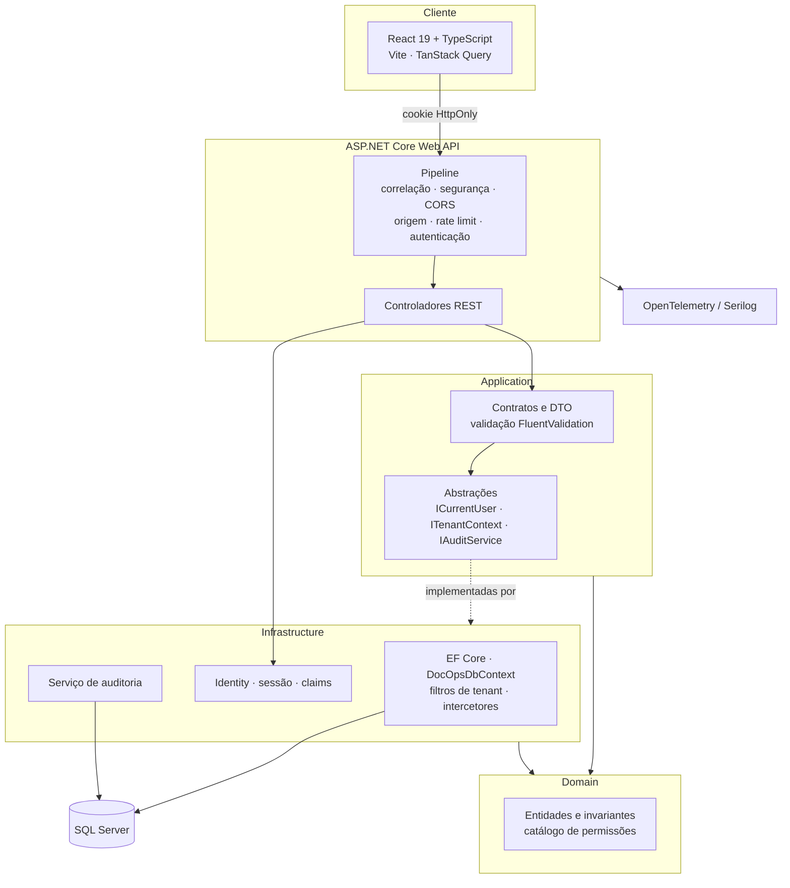
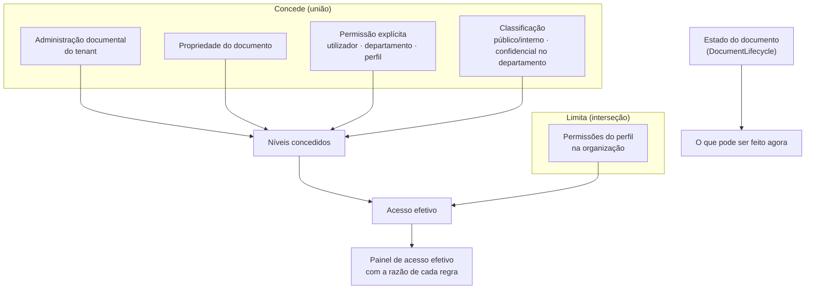
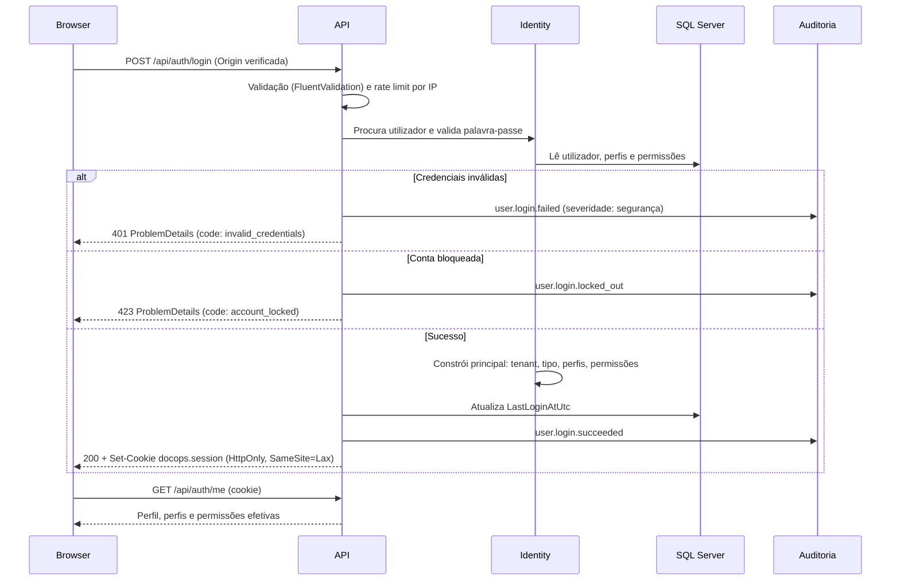

# DocOps Control Tower

**Transforme documentos em processos de negócio controlados e auditáveis.**

Plataforma de operações documentais que combina repositório documental governado, automação de
workflows, processamento assistido por IA, pesquisa segura e trilho de auditoria completo.

> **Projeto de portefólio independente.** Demonstração técnica pessoal, sem afiliação, associação ou
> relação com qualquer produto ou fornecedor comercial. Todas as organizações, pessoas e documentos
> usados na demonstração são fictícios.

---

## 1. Visão do produto

Nas organizações, os documentos que importam — faturas de fornecedor, contratos, encomendas,
processos de colaboradores — não são ficheiros: são o início de processos de negócio com
responsáveis, prazos, decisões e obrigações de conformidade. O DocOps Control Tower trata o
documento como aquilo que ele é, ligando repositório, metadados, circuito de aprovação, decisão e
prova.

## 2. Problema que resolve

| Problema operacional | Resposta da plataforma |
| --- | --- |
| Documentos dispersos por e-mail e pastas partilhadas | Repositório único com metadados, tipos e versões |
| Aprovações informais e sem rasto | Motor de workflow com tarefas, prazos e escalonamento |
| Introdução manual de dados de faturas e contratos | Classificação e extração assistida por IA com validação humana |
| "Quem viu, alterou ou aprovou isto?" | Registo de auditoria imutável e pesquisável |
| Acessos concedidos sem critério | Autorização por permissão, departamento e documento, validada no servidor |
| Retenção e obrigações legais geridas em folhas de cálculo | Políticas de retenção, classificação de sensibilidade e retenção legal |

## 3. Estado de construção

O projeto é construído por fases; cada fase é entregue a funcionar de ponta a ponta (base de dados,
API, interface e testes). Não existem ecrãs de demonstração estáticos: tudo o que a interface mostra
vem da base de dados através da API.

| Fase | Âmbito | Estado |
| --- | --- | --- |
| 1 | Arquitetura, solução, base de dados, autenticação, multi-tenancy, auditoria base | **Concluída** |
| 2 | Documentos, versões, permissões, auditoria documental | **Concluída** |
| 3 | Tarefas e motor de workflow | **Concluída** |
| 4 | Designer visual de workflow | Planeada |
| 5 | Abstração de IA e inteligência documental | Planeada |
| 6 | Pesquisa, caixa de entrada e integrações | Planeada |
| 7 | Portal externo e assinatura eletrónica | Planeada |
| 8 | Relatórios e administração | Planeada |
| 9 | Testes, segurança e observabilidade | Planeada |
| 10 | Refinamento de UX, acessibilidade, desempenho e documentação | Planeada |

### Entregue na Fase 1

- Monólito modular .NET 10 com fronteiras explícitas (`Domain`, `Application`, `Infrastructure`, `Api`).
- Base de dados SQL Server modelada com EF Core: chaves estrangeiras, índices, índices únicos
  filtrados, tokens de concorrência, *soft delete* e carimbos temporais automáticos.
- Multi-tenancy com isolamento imposto em duas camadas (filtros globais de leitura + intercetor de
  escrita).
- Autenticação por cookie `HttpOnly` com ASP.NET Core Identity, bloqueio por tentativas e política
  de palavra-passe.
- Autorização por permissões (não por perfis) com permissões guardadas em base de dados e
  políticas geradas a pedido.
- Trilho de auditoria imutável, já a registar autenticações, com identificador de correlação.
- API REST documentada em OpenAPI, `ProblemDetails` consistente, *rate limiting*, cabeçalhos de
  segurança e proteção CSRF por validação de origem.
- Observabilidade: logging estruturado (Serilog), OpenTelemetry e *health checks* `/health`,
  `/health/live`, `/health/ready`.
- Frontend React 19 + TypeScript com design system próprio, tema claro/escuro, pt-PT/en e
  navegação protegida.

### Entregue na Fase 2

- Repositório documental com tipos de documento configuráveis e esquema de metadados por tipo
  (campos tipados, obrigatórios, listas de valores) — o formulário da interface é gerado a partir do
  servidor, não codificado no cliente.
- Versionamento real: cada alteração de conteúdo cria uma nova versão com dimensão, `SHA-256` e
  autor; versões anteriores nunca são sobrescritas e continuam descarregáveis.
- Armazenamento de ficheiros atrás de `IFileStorage` (`LocalFileStorage` em disco), com validação de
  extensão, tipo de conteúdo e dimensão, e chave de armazenamento gerada pelo servidor.
- Autorização ao nível do documento: propriedade, permissões explícitas (utilizador, departamento,
  perfil), classificação de sensibilidade e teto imposto pelas permissões do perfil — com um painel
  de **acesso efetivo** que explica cada decisão.
- Máquina de estados do documento (rascunho → revisão → aprovação → aprovado/rejeitado → assinatura →
  arquivo), com arquivo, restauro e eliminação reversível.
- Políticas de retenção por tipo de documento, com data de expiração calculada no arquivo.
- Pesquisa e filtros com paginação no servidor, aplicando as regras de acesso dentro da consulta SQL.
- Concorrência otimista ponta a ponta: o cliente devolve o token recebido e uma gravação baseada numa
  leitura desatualizada é recusada.
- Auditoria documental completa: criação, consulta, descarregamento, alteração de metadados, mudança
  de estado, nova versão, concessão e revogação de permissões, arquivo, restauro e eliminação.
- Dados de demonstração: 37 documentos consistentes (com versões, etiquetas, metadados, permissões e
  histórico de auditoria retroativo) em 8 tipos de documento.

### Entregue na Fase 3

- **Motor de workflow próprio**, orientado a dados: definições com nós e ligações persistidas,
  executadas como instâncias com estado, variáveis e cronologia.
- Tipos de nó executáveis: início, tarefa humana, aprovação, condição, notificação, ramificação
  paralela, junção, temporizador e fim. Os tipos ainda não implementados (IA, integrações) **falham
  de forma explícita** em vez de serem ignorados, e a validação impede ativar uma definição que os use.
- **Uma travessia é uma transação**: o motor percorre os nós até cada ramo ficar parado ou terminado
  e só então persiste — instância, tarefas, cronologia e estado do documento ficam sempre coerentes.
- **Centro de tarefas** com âmbitos (minhas / organização / delegadas), indicadores de SLA, prazos,
  prioridade, escalonamento e ações decididas no servidor (aprovar, rejeitar, concluir, pedir
  informação, assumir, reatribuir).
- Tarefas de grupo: uma tarefa oferecida a um departamento ou perfil é visível a quem pertence a esse
  grupo e fica atribuída a quem age sobre ela.
- **Cronologia por instância**, com transições de estado do documento, decisões, notificações e
  escalonamentos.
- **Validação de definições** (nós sem saída, ramos em falta, nós inalcançáveis, atribuição em falta),
  distinguindo erros — que impedem a ativação — de avisos.
- **Worker em processo separado** para o que não pertence ao pedido HTTP: escalonamento de prazos e
  retoma de temporizadores.
- Notificações na aplicação, com contador por ler no cabeçalho.
- Dados de demonstração: 3 definições e 15 instâncias com tarefas pendentes, em atraso, escaladas,
  concluídas e uma rejeitada — coerentes com o estado dos documentos.

### Cobertura de testes acumulada

| Nível | Contagem |
| --- | --- |
| Unitários (xUnit) | 143 |
| Integração com SQL Server real (Testcontainers) | 49 |
| Componente (Vitest + Testing Library) | 8 |
| End-to-end (Playwright, desktop e móvel) | 30 |

## 4. Arquitetura



**Porquê um monólito modular:** o domínio é altamente transacional e fortemente relacionado
(documento → workflow → tarefa → auditoria). Microserviços introduziriam consistência eventual e
custo operacional sem benefício correspondente nesta escala. As fronteiras entre módulos são
explícitas no código, o que mantém aberta a opção de extrair um módulo mais tarde.
Ver [ADR-001](docs/adr/ADR-001-modular-monolith.md).

Documentação detalhada: [`docs/ARCHITECTURE.md`](docs/ARCHITECTURE.md).

## 5. Stack tecnológica

| Camada | Tecnologia |
| --- | --- |
| Backend | .NET 10, C# 14, ASP.NET Core Web API, EF Core 10 |
| Base de dados | SQL Server 2022 (container) |
| Identidade | ASP.NET Core Identity, cookies `HttpOnly`, autorização por permissões |
| Validação | FluentValidation |
| Observabilidade | Serilog, OpenTelemetry, health checks |
| Frontend | React 19, TypeScript, Vite, TanStack Query, React Hook Form, Zod, Tailwind CSS 4, i18next |
| Testes | xUnit, Testcontainers, Vitest, Testing Library, Playwright |
| Infraestrutura | Docker Compose, GitHub Actions |

## 6. Modelo de segurança

- **A interface nunca é fonte de verdade.** Todas as decisões de autorização são tomadas no servidor;
  o frontend apenas esconde o que o utilizador não pode usar.
- **Tenant nunca vem do cliente.** O identificador da organização é lido exclusivamente das *claims*
  do cookie de sessão. Não existe rota, cabeçalho ou campo que o aceite.
- **Isolamento em duas camadas.** Filtros globais de consulta impedem leituras cruzadas;
  `TenantGuardInterceptor` recusa escritas cruzadas com exceção explícita e registo de erro.
- **Permissões, não perfis.** Os *endpoints* exigem permissões (`documents.approve`), guardadas como
  *claims* de perfil na base de dados e editáveis sem novo *deploy*.
- **Sessão em cookie `HttpOnly`, `SameSite=Lax`.** Nenhum token é acessível a JavaScript. CSRF é
  mitigado pelo `SameSite` e por validação de `Origin`/`Referer` em todos os métodos que alteram estado.
- **Auditoria imutável.** A aplicação recusa alterar ou apagar registos de auditoria; a base de dados
  revoga `UPDATE`/`DELETE` ao *login* aplicacional.

Detalhe completo: [`docs/SECURITY.md`](docs/SECURITY.md).

## 7. Desenho da base de dados


Decisões de modelação relevantes:

- **Identificadores UUIDv7** (`Guid.CreateVersion7()`): únicos e sequenciais, evitando a fragmentação
  de índice típica de GUIDs aleatórios. As chaves são geradas pela aplicação e o modelo declara-o
  (`ValueGeneratedNever`) — sem isso, o EF Core interpreta "a chave já tem valor" como "esta linha já
  existe" e emite `UPDATE` onde era preciso `INSERT`.
- **`rowversion` como token de concorrência** nas entidades mutáveis, devolvido ao cliente e exigido
  na gravação.
- **Índices únicos filtrados** (referência do documento, código de departamento, etiqueta) que
  ignoram registos eliminados, permitindo reutilizar um código após eliminação.
- **Metadados tipados**: o valor é guardado como texto canónico *e* na coluna do seu tipo, para que
  filtros e ordenações corram em SQL em vez de em memória.
- **Conteúdo fora da base de dados**: a linha da versão guarda a chave de armazenamento, a dimensão e
  o `SHA-256`; os bytes vivem no *file store* (ver [ADR-003](docs/adr/ADR-003-document-storage.md)).
- **Ator desnormalizado na auditoria**, para o trilho continuar legível depois de um utilizador mudar
  de nome ou ser desativado.

### Autorização documental



O acesso responde a *quem pode agir*; o ciclo de vida responde a *o que pode ser feito agora*. São
deliberadamente independentes: misturá-los tornava impossível arquivar um documento aprovado.

## 8. Fluxo de autenticação



## 9. Superfície da API

Documentada em OpenAPI (`/openapi/v1.json`), navegável em `/scalar/v1` durante o desenvolvimento.

| Método e rota | Descrição |
| --- | --- |
| `POST /api/auth/login` · `POST /api/auth/logout` · `GET /api/auth/me` | Sessão e perfil do chamador |
| `GET /api/tenants/current` · `GET /api/tenants/current/departments` | Organização do chamador |
| `GET /api/documents` | Lista paginada e filtrada, limitada ao que o chamador pode ver |
| `POST /api/documents` | Cria um documento a partir de um ficheiro (multipart) |
| `GET /api/documents/{id}` | Detalhe, versões, metadados e acesso efetivo |
| `PUT /api/documents/{id}` | Edita metadados (exige o token de concorrência) |
| `POST /api/documents/{id}/versions` | Acrescenta uma versão |
| `GET /api/documents/{id}/content` | Descarrega a versão atual ou uma específica |
| `POST /api/documents/{id}/status` | Transição de estado validada pela máquina de estados |
| `POST /api/documents/{id}/archive` · `/restore` · `DELETE /api/documents/{id}` | Arquivo, restauro e eliminação reversível |
| `GET /api/documents/{id}/audit` | Trilho de auditoria do documento |
| `GET /api/workflows` · `/{id}` | Definições de workflow e o seu grafo |
| `POST /api/workflows/{id}/test` | Valida uma definição sem a executar |
| `POST /api/workflows/{id}/activate` · `/deactivate` | Ativação (recusada se houver erros de validação) |
| `GET /api/workflows/instances` · `/{id}` | Execuções, com cronologia, tarefas e variáveis |
| `POST /api/workflows/instances` | Inicia um processo sobre um documento |
| `POST /api/workflows/instances/{id}/cancel` | Cancela um processo e fecha as tarefas em aberto |
| `GET /api/tasks` · `/statistics` | Centro de tarefas e indicadores |
| `POST /api/tasks/{id}/approve` · `/reject` · `/complete` · `/request-information` | Decisões sobre uma tarefa |
| `POST /api/tasks/{id}/claim` · `/reassign` | Assumir e reatribuir |
| `GET /api/notifications` · `/unread-count` | Notificações do utilizador |
| `GET/POST/DELETE /api/documents/{id}/permissions` | Permissões do documento |
| `GET /api/documents/{id}/effective-access` | Acesso efetivo, com a razão de cada regra |
| `GET /api/document-catalogue/types` · `/tags` · `/retention-policies` | Dados de referência dos formulários |
| `GET /health` · `/health/live` · `/health/ready` | Estado do sistema |

## 10. Motor de workflow


O motor percorre a definição de nó em nó até cada ramo ficar **parado** (alguém tem de agir, ou um
temporizador tem de decorrer) ou **terminado**, e só então grava. Uma travessia é uma transação: a
instância, as suas tarefas, a cronologia e a alteração de estado do documento ficam consistentes
entre si, e uma falha a meio deixa a instância exatamente onde estava.

Princípios que valem a pena destacar:

- **O motor não contorna as regras do documento.** Uma alteração de estado configurada num nó passa
  pela máquina de estados do documento; se a transição for ilegal, a instância para com o motivo
  registado em vez de forçar um estado inválido.
- **Tipos de nó sem executor falham de forma explícita.** Um processo desenhado com um nó de IA não
  pode sequer ser ativado — a validação recusa-o — e, se lá chegasse, pararia com a razão visível na
  cronologia em vez de saltar o passo.
- **As condições não são uma linguagem de expressões**, mas um operador de um conjunto fechado sobre
  uma variável nomeada: suficiente para as regras que um utilizador de negócio desenha, e impossível
  de transformar num meio de executar código a partir de dados guardados.
- **Trabalho de grupo é trabalho reclamável.** Uma tarefa oferecida a um departamento ou perfil fica
  por atribuir até alguém agir sobre ela; nesse momento fica registada a quem pertence a decisão.

Desenho e alternativas ponderadas: [ADR-006](docs/adr/ADR-006-workflow-engine.md).

## 11. Processamento em segundo plano

O projeto `src/Worker` é um processo separado da API. Corre, num intervalo configurável:

- **Retoma de temporizadores**: instâncias paradas num nó de espera cuja data chegou. Enquanto
  esperam não custam nada — nem uma linha de execução, nem uma ligação: apenas uma data numa coluna.
- **Escalonamento de prazos**: tarefas em aberto que passaram a data limite são escaladas uma única
  vez, notificando o responsável do departamento (ou quem iniciou o processo), com entrada na
  cronologia e registo de auditoria.

Corre sem organização no contexto ambiente, o que é precisamente o que lhe permite ver todas as
organizações. É uma exceção deliberada e confinada: nada disto é alcançável a partir de um pedido HTTP.

## 12. Arquitetura de IA

A aplicação depende de abstrações (`IAiDocumentService`, `IAiSearchService`, `IAiWorkflowService`) e
nunca de um fornecedor concreto. O fornecedor de demonstração é determinístico e identificado como
tal na interface — respostas de demonstração nunca são apresentadas como geradas por um modelo real.
Ver [ADR-004](docs/adr/ADR-004-ai-provider-abstraction.md). *Implementação prevista para a Fase 5.*

## 13. Estratégia de integrações

Cada integração externa (correio eletrónico, ERP, CRM, assinatura, webhooks) é representada por um
adaptador atrás de uma interface, com registo de sincronizações e erros. O desenvolvimento local
nunca exige credenciais de terceiros. *Implementação prevista para a Fase 6.*

## 14. Observabilidade

- **Logs estruturados** (Serilog) com `CorrelationId`, `UserId` e propriedades de pedido.
- **Correlação ponta a ponta**: o mesmo identificador aparece no cabeçalho `X-Correlation-Id` da
  resposta, nos logs, no *trace* e em cada registo de auditoria do pedido.
- **OpenTelemetry** para *traces* e métricas de ASP.NET Core e HttpClient; exportação OTLP ativada
  apenas quando existe *endpoint* configurado.
- **Health checks**: `/health/live` (processo vivo), `/health/ready` (dependências prontas),
  `/health` (visão completa) — sem revelar detalhe de infraestrutura.

## 15. Estratégia de testes

| Nível | Ferramenta | O que garante |
| --- | --- | --- |
| Unitário | xUnit | Avaliação de permissões, catálogo de perfis, leitura de identidade, paginação, validação |
| Integração | xUnit + Testcontainers (SQL Server real) | Autenticação, auditoria, isolamento de tenant, *soft delete*, imutabilidade da auditoria, cabeçalhos de segurança |
| Componente | Vitest + Testing Library | Formulários, estados de erro, contrato do cliente HTTP |
| End-to-end | Playwright (desktop e móvel) | Percursos reais no browser, incluindo cookie `HttpOnly` e troca de idioma |

Os testes de integração correm contra SQL Server em container, com as mesmas migrações da aplicação:
não há base de dados em memória a mascarar comportamento relacional.

## 16. Estratégia de implantação

`docker compose up` levanta a base de dados; a API aplica migrações e semeia dados de demonstração em
desenvolvimento. Em produção, as migrações são um passo explícito do pipeline e a semeadura está
desligada. As abstrações de armazenamento, IA e identidade permitem mover para Azure Blob Storage,
Azure SQL, Azure OpenAI e Microsoft Entra ID sem alterar o código de domínio — e nada disso é
necessário para correr o projeto localmente.

## 17. Compromissos assumidos

| Decisão | Alternativa ponderada | Porque assim |
| --- | --- | --- |
| Monólito modular | Microserviços | Domínio transacional e coeso; evita consistência eventual desnecessária |
| Um tenant por utilizador | Adesão N:N a organizações | Simplifica cada consulta e o início de sessão; administradores de plataforma cobrem o caso excecional |
| Permissões em *claims* de perfil | Tabela de permissões própria | Reutiliza a infraestrutura do Identity; permissões editáveis sem novo *deploy* |
| `IdentityUser` no domínio | Entidade de domínio separada do utilizador de autenticação | Evita duplicação de modelos e sincronização entre eles; ver [ADR-002](docs/adr/ADR-002-authentication.md) |
| Cookies em vez de JWT | *Bearer tokens* no cliente | Sem token acessível a JavaScript; XSS não permite roubo de sessão |
| Validação de `Origin` | *Tokens* antifalsificação | Protege toda a API sem estado adicional no cliente; `SameSite=Lax` cobre o resto |
| Sem MediatR/CQRS | Pipeline de comandos e consultas | Custo de indireção não justificado nesta dimensão |
| Conteúdo fora da base de dados | `varbinary(max)` ou `FILESTREAM` | Base pequena e rápida; mesmo código em disco local e em armazenamento de objetos |
| Acesso separado do ciclo de vida | Um único cálculo de "pode editar" | Misturá-los tornava impossível arquivar um documento aprovado |
| Metadados em EAV com colunas tipadas | Coluna por campo, ou só JSON | Esquema configurável pelo cliente sem perder filtros e ordenações em SQL |
| Motor de workflow próprio | Elsa, BPMN, WF | Persistência e identidade próprias colidiriam com o isolamento e a auditoria; ver [ADR-006](docs/adr/ADR-006-workflow-engine.md) |
| Condições como operador sobre variável | Linguagem de expressões | Suficiente para regras de negócio, e sem superfície para executar código a partir de dados |
| Worker em processo separado | Trabalho em segundo plano dentro da API | Trabalho periódico e lento não partilha recursos com pedidos de utilizadores |

## 18. Melhorias futuras

- Extração de módulo de IA para processo próprio caso o volume o justifique.
- Pesquisa por texto integral com índices de SQL Server e ranking por relevância.
- Adesão de um utilizador a várias organizações, com seletor de contexto auditado.
- Aplicação instalável (PWA) com trabalho offline para consulta documental.
- Exportação de auditoria assinada criptograficamente.
- Idiomas adicionais (es, fr, ro) — a arquitetura de localização já os suporta.

---

## Começar

Pré-requisitos, comandos e credenciais: [`docs/SETUP.md`](docs/SETUP.md).
Guião da demonstração: [`docs/DEMO.md`](docs/DEMO.md).

```bash
docker compose up -d                                  # SQL Server
dotnet run --project src/Api/DocOps.Api.csproj        # API    → http://localhost:5180
npm --prefix src/Web run dev                          # Web    → http://localhost:5173
dotnet run --project src/Worker/DocOps.Worker.csproj  # Worker (opcional: prazos e temporizadores)
```
