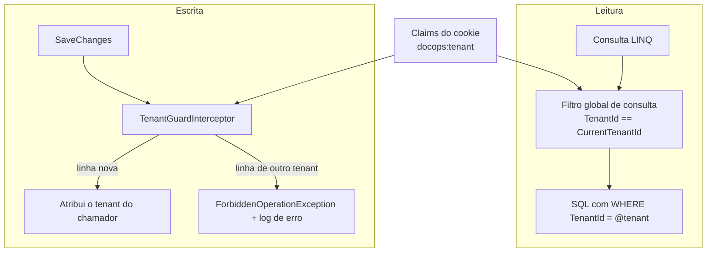
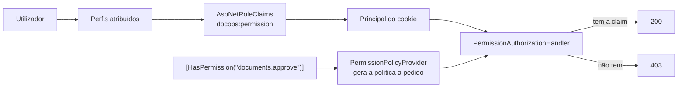
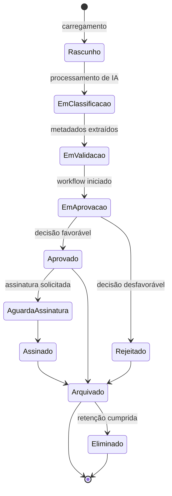
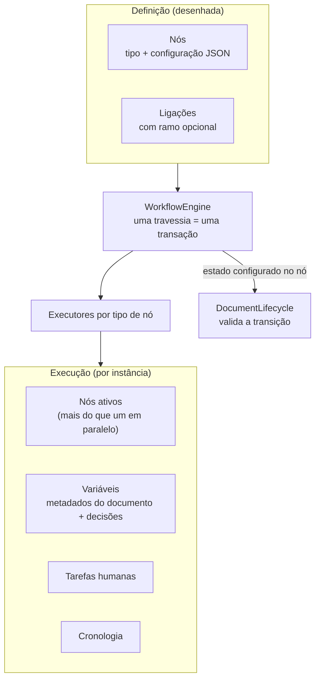
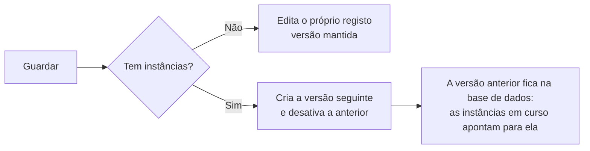
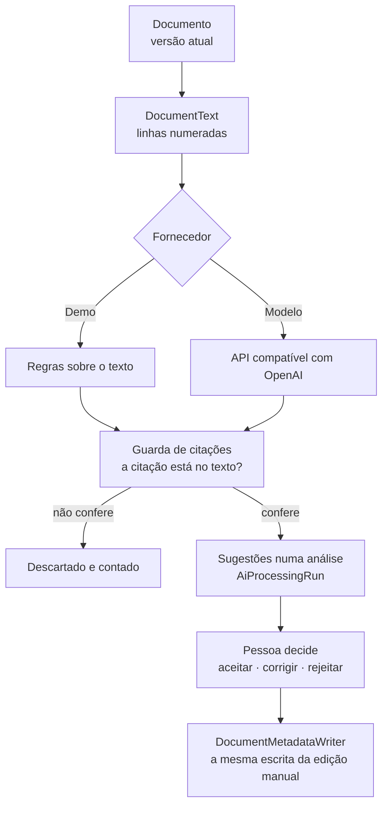

# Arquitetura

## 1. Princípios

1. **Fronteiras explícitas, um único processo.** Os módulos comunicam por interfaces, não por rede.
2. **A base de dados é a fonte de verdade.** A interface apresenta estado; não o define.
3. **Segurança no servidor.** Todas as decisões de autorização são tomadas e revalidadas no backend.
4. **Simplicidade deliberada.** Um padrão só entra quando o problema que resolve já existe no código.
5. **Observável por omissão.** Cada pedido é correlacionável entre logs, *traces* e auditoria.

## 2. Estrutura da solução

```
src/
  Domain/          Entidades, invariantes, catálogo de permissões. Sem dependências de infraestrutura.
  Application/     Contratos (DTO), validação e abstrações (ICurrentUser, ITenantContext, IAuditService).
  Infrastructure/  EF Core, Identity, auditoria, implementação das abstrações. Detalhes substituíveis.
  Api/             Pipeline HTTP, controladores, tratamento de erros, observabilidade.
  Web/             Aplicação React (TypeScript, Vite).
tests/
  UnitTests/        Regras puras: permissões, catálogo de perfis, paginação, validação.
  IntegrationTests/ API real + SQL Server real (Testcontainers).
  e2e/              Playwright: percursos completos no browser.
docs/               Documentação e registos de decisão de arquitetura (ADR).
```

A direção das dependências é sempre para dentro: `Api → Infrastructure → Application → Domain`.
O `Domain` não conhece EF Core, HTTP nem React.

### Uma exceção consciente

`Domain` referencia `Microsoft.Extensions.Identity.Stores` para que `ApplicationUser` derive de
`IdentityUser<Guid>`. A alternativa pura, uma entidade de domínio `User` separada do utilizador de
autenticação, obrigaria a sincronizar dois modelos do mesmo conceito, um custo permanente para um
benefício teórico. Ver [ADR-002](adr/ADR-002-authentication.md).

## 3. Módulos de domínio

| Módulo | Responsabilidade |
| --- | --- |
| Identity & Access | Autenticação, perfis, permissões, sessão |
| Organizations / Tenancy | Organizações, departamentos, adesões |
| Audit & Compliance | Registo imutável, retenção, classificação, retenção legal |
| Document Management | Documentos, versões, metadados, permissões documentais |
| Document Classification | Tipos de documento e campos de metadados |
| Workflow Management / Execution | Definições, desenho visual, instâncias, estados, prazos |
| Tasks & Approvals | Tarefas humanas, aprovações, delegação, SLA |
| AI Intelligence | Classificação, extração, perguntas sobre documentos |
| Search | Pesquisa por metadados, texto integral e linguagem natural |
| Email / Inbox | Caixa de entrada e processamento de anexos |
| Integrations | Adaptadores externos, execução e registo por organização |
| External Portal | Submissões de parceiros e o seu acompanhamento |
| Electronic Signature | Pedidos e estados de assinatura |
| Reporting & Analytics | Indicadores e gráficos a partir de dados reais |
| Notifications | Notificações e escalonamentos |
| Administration | Gestão de utilizadores, perfis, departamentos e definições |

## 4. Pipeline de pedido


Cada camada tem uma responsabilidade única e é testada: os testes de integração verificam os
cabeçalhos de segurança, o bloqueio por origem, o tratamento de erros e as respostas de autenticação.

## 5. Multi-tenancy

O isolamento é aplicado em dois pontos independentes, para que um esquecimento numa consulta não se
transforme numa fuga de dados:



O tenant é lido exclusivamente das *claims* da sessão (`ICurrentUser` → `ITenantContext`). Contextos
sem utilizador autenticado (migrações, semeadura, trabalhos em segundo plano) não aplicam filtro,
o que é seguro porque não existe *endpoint* com dados de organização acessível sem autenticação.

Administradores de plataforma não contornam o filtro implicitamente: o acesso entre organizações
exige `IgnoreQueryFilters()` num serviço dedicado e é auditado.

## 6. Autorização



As permissões residem na base de dados, o que permite a um administrador alterar o que um perfil pode
fazer sem novo *deploy*. A revalidação do *security stamp* a cada 5 minutos faz com que uma permissão
revogada deixe de funcionar sem esperar pelo fim da sessão.

A autorização ao nível do recurso está implementada para documentos em
`DocumentAccessEvaluator`: uma função pura que recebe os factos do documento, os factos do chamador e
as permissões explícitas, e devolve os níveis concedidos **com a razão de cada regra**. É essa
explicação que alimenta o painel de *acesso efetivo* na interface.

Uma separação deliberada: o avaliador responde a *quem pode agir*; `DocumentLifecycle` responde a *o
que pode ser feito no estado atual*. Misturá-las tornaria impossível
arquivar um documento aprovado, porque o estado "aprovado" retira o direito de edição que o arquivo
exige.

## 7. Persistência

- **EF Core 10 com SQL Server.** Configuração por *Fluent API* em classes `IEntityTypeConfiguration`.
- **Identificadores UUIDv7** (`Guid.CreateVersion7()`), gerados pela aplicação e declarados
  `ValueGeneratedNever`: a entidade tem identidade antes de ser gravada, e o EF não confunde uma
  versão nova de um documento com uma existente. Por serem sequenciais, evitam a fragmentação de
  índice típica de GUIDs aleatórios.
- **Concorrência otimista** por coluna `rowversion` nas entidades mutáveis. Um agregado guardado em
  várias tabelas, como a definição de um processo com os seus nós e ligações, marca sempre a linha
  principal como alterada ao gravar: assim o `rowversion` da definição é verificado mesmo quando só
  o desenho muda, e duas pessoas a editar o mesmo processo não se sobrepõem em silêncio.
- **Soft delete** com filtro global; a eliminação é reversível e o histórico preserva-se.
- **Índices únicos filtrados** (por exemplo, código de departamento único por organização, ignorando
  registos eliminados) e índices compostos orientados às consultas reais.
- **Intercetores** para carimbos temporais, autor da alteração, *soft delete*, isolamento de tenant e
  imutabilidade da auditoria: comportamento transversal fora do código de negócio.
- **Paginação no servidor** e projeções (`Select`) em vez de carregar grafos inteiros. Toda a
  ordenação paginada termina na chave: cada página é uma consulta independente, e com a ordenação a
  empatar a mesma linha podia aparecer em duas páginas e outra em nenhuma.

### Ciclo de vida do documento



Cada transição é uma regra de domínio no backend e gera um registo de auditoria. Uma alteração de
conteúdo cria sempre uma nova versão; versões anteriores nunca são sobrescritas.

## 8. Auditoria

Um registo de auditoria contém o que aconteceu, quem o fez, quando, em que organização, a partir de
que endereço, com que identificador de correlação e, quando aplicável, o estado antes e depois.

- O ator é resolvido pelo serviço a partir do contexto do pedido, nunca indicado pelo chamador: uma
  ação não pode ser atribuída ao utilizador errado por engano de quem chama.
- A escrita ocorre num contexto próprio, para que um registo de auditoria não seja revertido com a
  transação de negócio que descreve.
- Campos sensíveis (palavras-passe, segredos, chaves) são redigidos antes da serialização.
- `AuditImmutabilityInterceptor` recusa qualquer `UPDATE` ou `DELETE`, e a base de dados recusa-os
  também às duas identidades com que a aplicação se liga, para que SQL escrito à mão não passe ao
  lado do intercetor (ver `SECURITY.md`).

## 9. Frontend

- **Estado do servidor** em TanStack Query; a sessão é uma consulta como outra qualquer, o que
  elimina a duplicação entre "estado de autenticação" e "dados do utilizador".
- **Formulários** com React Hook Form e esquemas Zod; as mensagens de erro são chaves de tradução,
  não texto fixo.
- **Erros da API** chegam como `application/problem+json` e são convertidos em `ApiError`, com um
  `code` estável que o frontend traduz: o servidor não precisa de conhecer o idioma do utilizador
  para produzir uma mensagem correta. O cliente reconhece qualquer `content-type` terminado em
  `+json`, porque `application/problem+json` não contém o texto `application/json`, e um teste por
  esse texto descartaria os códigos de erro e as mensagens por campo.
- **Design system** em *tokens* CSS (cor, espaçamento, tipografia, raio, sombra) com tema claro e
  escuro; os componentes referenciam *tokens* semânticos (`surface`, `ink`, `border`), nunca cores
  diretas.
- **Navegação orientada a dados e a permissões**: uma entrada só existe quando a rota, a API e a
  persistência existem.

## 9.1 Acessibilidade e carregamento

**A acessibilidade é medida, não afirmada.** `tests/e2e/specs/accessibility.spec.ts` corre `axe`
contra WCAG 2.1 A e AA sobre dez ecrãs, nos dois perfis de browser, mais o modo escuro e o estado
com um diálogo aberto. As regras que exigem julgamento humano ficam de fora de propósito: um teste
que falha sem se poder saber porquê é um teste que se aprende a ignorar.

**O contraste vive nos tokens, e o token tem a razão escrita ao lado.** `--color-graphite-550`
existe por um número, não por gosto: o degrau 500 dá 4.06:1 sobre o fundo recuado, e a norma pede
4.5:1 para texto normal. Um comentário no CSS diz isso, para o próximo que lá passar não o «limpar».

**Uma tabela que desliza tem de se conseguir deslizar sem rato.** `TableScroller` é um contentor
focável: sem `tabIndex`, quem navega por teclado não tem como chegar ao contentor para o mover, e as
colunas fora do ecrã deixam de existir. Existe como componente porque cinco sítios cometeram o mesmo
erro.

**As rotas chegam quando alguém lá vai.** Ficam imediatos os ecrãs anteriores à sessão e o painel,
que é o primeiro a seguir ao início de sessão; as outras catorze são adiadas atrás de uma fronteira
`Suspense` única. Assim, o pacote de entrada, que é o que se descarrega antes de se ver seja o que for,
leva só o que esses ecrãs precisam.

## 10. Motor de workflow



O motor percorre os nós até cada ramo ficar parado, à espera de uma pessoa ou de um temporizador, ou
terminado, e só então persiste. Consequências que importam:

- **Consistência**: instância, tarefas, cronologia e estado do documento gravam juntos. Uma falha a
  meio da travessia deixa a instância exatamente onde estava.
- **Falhar em vez de saltar**: um tipo de nó sem executor, uma ligação em falta ou uma transição de
  documento ilegal param a instância com o motivo registado na cronologia. Um processo que se
  "desenrasca" sozinho é pior do que um processo que para e diz porquê.
- **Espera sem custo**: uma instância parada não consome nada além de uma data numa coluna; o worker
  retoma-a quando a data chega.
- **Separação de responsabilidades**: `DocumentAccessEvaluator` diz quem pode agir,
  `DocumentLifecycle` diz o que pode ser feito ao documento agora, e o motor diz para onde o processo
  segue. Nenhum dos três decide pelos outros.

### O desenhador e o versionamento das definições

O desenhador escreve exatamente o mesmo modelo que o motor lê: nós com tipo e configuração em JSON,
ligações com ramo opcional. Não existe um formato de desenho separado do formato de execução.

A regra que decide o que acontece ao guardar é uma só: **uma instância em curso tem de continuar a
resolver os nós com que arrancou.**



Consequências que moldaram o desenho:

- O índice único das definições é `(TenantId, Code, Version)`, e não `(TenantId, Code)`. Várias
  versões do mesmo processo coexistem por construção, não por acidente.
- Guardar marca sempre o registo da definição como alterado. Nós e ligações vivem em tabelas
  próprias: sem isto, uma gravação feita a partir de uma leitura desatualizada reescreveria o grafo
  sem que o `rowversion` chegasse a ser verificado. Foi um teste de integração que revelou a falha.
- Uma cópia nasce sempre inativa e na versão 1: duplicar um processo ativo não pode pôr um segundo
  processo a arrancar sozinho.
- Eliminar é recusado enquanto houver execuções em curso, e é reversível quando é aceite.

A validação está dividida por propósito, não duplicada. O desenhador assinala no momento o que é
óbvio ao desenhar (um passo sem saída, um passo que nenhuma ligação alcança, uma condição sem os dois
ramos) para dar resposta imediata; o servidor é quem decide se um processo pode ser ativado, e é a
sua validação que aparece na lista de problemas. Um processo por acabar **pode** ser guardado: estar
meio desenhado é um estado normal de trabalho.

## 10.1 Inteligência documental



Três invariantes sustentam a inteligência documental, e estão no código, e não na interface.

**A origem viaja com o resultado.** `AiSource` (`Demo` ou `Model`) faz parte de cada contrato que
carrega saída de IA. Nenhum cliente consegue mostrar uma resposta de demonstração como sendo de um
modelo, porque não lhe chega nada sem essa etiqueta.

**Uma citação é um sítio onde ir ver, não uma afirmação.** `DocumentText` numera as linhas do
documento, a mesma numeração que o endpoint `/text` serve à interface, e `Verifies` confirma que
as palavras citadas estão mesmo na linha indicada. O `AiDocumentAnalyzer` aplica essa guarda a tudo
o que um fornecedor devolve, seja ele qual for. Ao fornecedor de modelo exige-se mais: o valor tem
de se poder reler a partir da citação, porque um modelo pode citar bem e inventar o número ao lado.

**Nada chega ao documento sem decisão.** A análise é uma entidade com estado (`AiProcessingRun`) e
cada sugestão tem a sua decisão, o seu autor e o seu momento. Aplicar escreve pelo
`DocumentMetadataWriter`, o mesmo componente que a edição manual usa: a IA não tem porta lateral,
e por isso herda a tipagem, a validação e a regra de campos obrigatórios sem as duplicar.

O tipo **«Por classificar»** existe para que o resto seja possível: sem campos obrigatórios, um
ficheiro pode ser guardado antes de alguém o ler. Reclassificar nunca baixa a sensibilidade (o
documento fica com a classificação mais restritiva entre a sua e a do tipo novo), e a política de
retenção acompanha o tipo apenas quando era a do tipo anterior.

Nos workflows, um passo de IA **não chama o fornecedor**: cria uma análise em fila e estaciona a
instância. Chamar um modelo dentro da travessia manteria uma transação de base de dados aberta
durante toda a resposta. O worker processa a fila fora de qualquer transação e retoma a instância,
que na segunda visita ao nó lê o resultado para variáveis `ai.*`.

## 10.2 Pesquisa

A pesquisa é **uma consulta**. O predicado de autorização, os filtros, a correspondência de texto, o
peso de relevância e a página resolvem-se todos no SQL Server, dentro do conjunto de documentos que
quem pergunta pode ver. Daí que o total apresentado seja o total que essa pessoa pode conhecer, e
não o que existe: contar primeiro e filtrar depois transformaria a contagem numa fuga.

Os filtros vivem num sítio só, `DocumentFilters`, partilhado entre a lista de documentos e o ecrã
de pesquisa, para que um filtro não signifique uma coisa num ecrã e outra no outro. Dois deles são
**derivados** e não guardados: o estado do processo lê-se da instância de workflow mais recente do
documento, e o estado de aprovação lê-se das tarefas de decisão levantadas para ele. Uma cópia no
documento seria mais uma coisa capaz de discordar dos factos.

O texto integral depende de um componente **opcional** do SQL Server. A aplicação não o pressupõe:

- `FullTextAvailability` pergunta uma vez ao servidor se o componente existe e se os índices da
  migração existem, e guarda a resposta.
- Com índice, `CONTAINS` responde sobre título, referência, resumo, texto extraído e valores de
  metadados; sem índice, as mesmas colunas são comparadas por subcadeia.
- Cada resposta declara qual dos dois caminhos correu, e a interface mostra-o. Uma pesquisa
  degradada em silêncio pareceria uma pesquisa que encontrou menos.

O que a interface realça num excerto vem do servidor, que encontrou as palavras no texto guardado,
com a mesma disciplina das citações da IA: o ecrã não volta a procurar, e por isso não pode realçar
algo que o documento não diga.

As perguntas em linguagem natural passam por `IAiSearchService`, que devolve **filtros** e nunca
resultados. O leitor de demonstração é uma tabela de expressões mais uma consulta ao catálogo da
própria organização; o leitor por modelo recebe a pergunta e os nomes do catálogo, e cada nome que
devolve é reconferido contra esse catálogo. Um leitor capaz de alcançar os dados poderia ser
convencido a alcançar dados que quem pergunta não pode ver. Detalhes e alternativas rejeitadas em
[ADR-005](adr/ADR-005-search-architecture.md).

## 10.3 Caixa de entrada

O correio entra por um adaptador e sai como documento pelos serviços que já existiam.

`IMailConnector` tem a forma do Microsoft Graph de propósito: listar mensagens de uma caixa, depois
buscar o conteúdo de **um** anexo por identificador. Daí decorre uma escolha que parece pequena e não
é: os bytes de um anexo **não** são copiados na sincronização, só quando alguém decide que o ficheiro
vale a pena. Copiar tudo encheria o repositório com os anexos que ninguém quis, e obrigaria a uma
forma de armazenamento que o Graph não tem.

A mensagem é **prova**, não documento. O corpo e a lista de anexos ficam como o servidor de correio
os entregou; processá-la *produz* documentos a partir dela e regista a ligação dos dois lados, para
que meses depois ainda seja possível responder a «de onde veio esta fatura». Por isso a mensagem
também não desaparece com o documento que produziu: a chave estrangeira é `NoAction` e o filtro da
mensagem é só o da organização, não o do documento.

Nada aqui escreve no repositório por atalho. Um anexo guardado como documento é criado pelo
`IDocumentService`; um processo iniciado a partir de uma mensagem é iniciado pelo `IWorkflowService`.
Cada um aplica a sua própria permissão por cima da permissão de processar a caixa: guardar um anexo
exige também `documents.create`, e iniciar um processo exige `workflows.start`.

O ciclo de vida da mensagem é deliberadamente curto: por ler, lida, processada, arquivada.
`EmailLifecycle` diz o que o estado permite, tal como `DocumentLifecycle` faz para documentos, e o
que a interface esconde é conveniência, e o servidor recusa na mesma.

Detalhes e alternativas rejeitadas em [ADR-007](adr/ADR-007-external-connectors.md).

## 10.4 Centro de integrações

`IIntegrationAdapter` é o `IMailConnector` generalizado: um adaptador recebe um contexto com a
organização e devolve um resultado com o que fez, quantos registos tocou, que estado deixa a
integração e as linhas que quer ver no registo. Seis estão escritos: correio, ERP, CRM, assinatura
eletrónica, webhooks e importação de ficheiros.

**Quem escreve o estado é o executor, não o adaptador.** `IntegrationExecutor` recebe o resultado e
é ele que grava `Status`, `RecordsProcessed`, `ErrorCount` e `LastRunAtUtc`, e que converte uma
exceção do adaptador em estado «Com falha» com a mensagem, e nunca a pilha. Se cada adaptador
escrevesse o seu próprio estado, o cartão passaria a ser a opinião do adaptador sobre si mesmo em
vez do registo do que aconteceu.

**Dois caminhos de execução, um executor.** `IntegrationService` corre no pedido do utilizador e usa
o `DbContext` filtrado pela organização, pelo que só alcança a integração de quem a pediu;
`IntegrationRunner` corre no worker, sem utilizador, e passa por `IgnoreQueryFilters` para varrer
todas as organizações, a mesma exceção consciente que o resto do trabalho periódico já tinha. Os
dois terminam no mesmo `IntegrationExecutor`, para que não haja duas formas de uma integração correr.

**O nó de workflow não chama nada dentro da transação do motor.** Uma travessia do grafo é uma
transação; uma chamada externa lá dentro manteria-a aberta à espera da rede.
`IntegrationNodeExecutor` enfileira um `IntegrationRunRequest` e devolve `Wait()`; o processador da
fila corre o pedido e retoma a instância. É a mesma forma dos nós de IA, de propósito.

**O registo de uma integração não é auditoria.** `IntegrationLog` é operacional: pode ser truncado,
não faz parte do trilho imutável. O que vai para a auditoria é o facto de alguém ter executado ou
reconfigurado a integração, não cada linha do que o adaptador relatou.

Detalhes e alternativas rejeitadas em [ADR-007](adr/ADR-007-external-connectors.md).

## 10.5 Portal externo

A primeira vez que o produto deixa entrar alguém de fora da organização, e a única parte da
aplicação cuja audiência não é um colaborador.

**Não tem autorização própria.** `PortalService` filtra com
`DocumentAccessResolver.BuildVisibilityPredicate`, o mesmo predicado da listagem interna, que já
concede a um utilizador externo apenas o que ele possui ou lhe foi explicitamente concedido, nunca
por rótulo de sensibilidade. Dois conjuntos de regras sobre os mesmos documentos acabariam por
divergir, e quando divergem é o mais permissivo que prevalece.

**Os contratos são tipos próprios.** `PortalSubmissionDto` não é o `DocumentListItemDto` com menos
campos: é um tipo diferente, projetado à mão. A repetição é o preço; o que se compra é que um campo
acrescentado do lado interno não atravesse sozinho no dia em que alguém o acrescenta.

**A cronologia é construída por seleção, não por exclusão.** O fornecedor vê os eventos
`information.requested` e `information.provided`, nomeados um a um. Uma lista construída como «tudo
menos o que é interno» deixaria entrar, por omissão, o tipo de evento que alguém
acrescentar a seguir.

**A separação corre nos dois sentidos**, e é navegação por cima de autorização: `RequirePortal`
reencaminha quem está do lado errado, e o servidor recusa de qualquer forma, porque nenhum perfil
interno detém `portal.access` e nenhum externo detém o que a aplicação interna exige.

Detalhes e alternativas rejeitadas em [ADR-008](adr/ADR-008-external-portal.md).

## 10.6 Assinatura eletrónica

**Demonstração de portefólio, sem validade legal.** Não é uma assinatura qualificada nem avançada: o
que existe é um registo de que uma pessoa concordou, num momento, com um conteúdo identificado por
resumo.

**A ligação ao conteúdo é o que torna o registo útil.** O pedido fixa `DocumentVersionId` e copia o
`ContentHash` dessa versão. Assinar compara; se divergir, recusa. Uma versão posterior não reescreve
o registo: `ContentStillMatches` passa a falso, que é a única das três leituras possíveis que é
verdadeira (as outras seriam apagar a prova, ou re-apontá-la em silêncio para conteúdo que ninguém
consentiu).

**Assinar não é editar.** A transição do documento para «assinado» é aplicada diretamente, validada
pelo `DocumentLifecycle` e não pelos direitos de quem age, exatamente como o motor de workflow
aplica estados. Exigir `Edit` obrigaria a distribuir direitos de edição só para recolher assinaturas.

**Assinar é pessoal.** `SignatureLifecycle.CanSign` compara o utilizador com o signatário nomeado, e
mais nada: nenhuma permissão contorna isso.

Detalhes e alternativas rejeitadas em [ADR-009](adr/ADR-009-electronic-signature.md).

## 10.7 Análises e relatórios

**Nenhum número é guardado.** Não há tabela de agregados nem cache: cada indicador do painel é uma
consulta executada no momento, sobre as mesmas tabelas que a aplicação usa para trabalhar. É uma
decisão com um custo assumido, porque o painel paga latência de consulta a cada abertura, e a alternativa,
agregados mantidos por um processo à parte, traz a única avaria que este projeto não pode ter: um
painel que discorda da lista que está ao lado dele. Ver [ADR-010](adr/ADR-010-analytics-from-queries.md).

**As consultas passam pelo predicado de visibilidade.** `ReportingService` reutiliza
`DocumentAccessResolver.BuildVisibilityPredicate`, o mesmo que a listagem, a pesquisa, o portal e
as execuções de processos usam. Uma contagem é uma fuga de informação como qualquer outra: saber que existem catorze documentos
confidenciais no departamento jurídico é saber alguma coisa sobre eles.

**Tudo tem de ser traduzível para SQL.** O agrupamento por dia usa
`EF.Functions.DateDiffDay(início, data)`, inteiros que o motor sabe agrupar, e as datas são
reconstruídas depois de ler. `DateOnly.FromDateTime` compila e rebenta em tempo de execução, que é a
pior ordem possível para descobrir o problema.

**A ausência de base é um valor.** `MetricDto.Value` é `decimal?`. Zero afirma que se mediu e deu
zero; `null` diz que não havia o que medir, e a interface escreve-o por extenso. Foi preciso olhar
para o ecrã com uma janela de sete dias para ver que o painel estava a afirmar `0%` de automação num
período em que nada havia para automatizar.

**Os estados atravessam a fronteira como números.** O servidor envia o valor da enumeração, não o seu
nome: `PendingApproval` é vocabulário interno, e um ecrã em português que o mostre está a expor a
implementação. O cliente traduz com as chaves que o resto da aplicação já usa; a exportação para CSV
reconverte para nomes legíveis, porque um ficheiro não tem quem o traduza.

## 10.8 Administração

**A organização vem sempre das *claims*.** `AdministrationService` nunca aceita um identificador de
organização vindo do pedido: o mesmo princípio de todo o resto, aplicado ao sítio onde a tentação é
maior, porque uma administração parece o lugar natural para «escolher a organização».

**Há uma mudança que o serviço recusa sempre: a própria conta.** `LoadEditableAsync` compara com o
utilizador atual e recusa antes de olhar para o que foi pedido. Não é cautela de interface: um
administrador que se desative, ou que se retire o perfil, cria uma avaria sem reparação de dentro do
produto. O DTO expõe `CanEdit` para o ecrã não oferecer o que o servidor vai recusar, mas a decisão é
do servidor.

**A conta de plataforma está acima da organização**, e por isso também não se gere a partir dela.
`IsPlatformAccount` no DTO existe para o ecrã poder dizer o motivo certo: as duas contas são
inalteráveis daqui, mas por razões diferentes, e uma única legenda para as duas seria falsa numa
delas.

**`SystemAdmin` não é oferecido nem aceite.** `EnsureRolesExistAsync` exclui-o do catálogo devolvido,
e guardar um perfil que não conste desse catálogo é recusado com `409`. Sem a segunda metade, bastava
enviar o nome à mão para uma organização se promover para fora da sua fronteira.

**Contas desativam-se, não se eliminam.** `IsActive` a falso tira a conta da lista de trabalho e
impede o início de sessão; a linha permanece, porque a auditoria, os documentos e as decisões
referem-se a ela. A palavra-passe inicial é gerada com `RandomNumberGenerator` e devolvida uma única
vez: o servidor guarda o resumo e não a sabe recuperar.

## 10.9 Catálogo de documentos

**O catálogo não é configuração: é uma promessa já cumprida.** Quando um tipo ganha um campo,
documentos passam a ser descritos por ele; quando um campo muda, muda o significado do que já está
escrito. Por isso o `DocumentCatalogueAdminService` faz a cada alteração uma única pergunta antes de
a aplicar: **torna falso alguma coisa que já está escrita?** Alargar é permitido; estreitar é
recusado, com a contagem que o explica.

**Os valores vivem em colunas tipadas.** `DocumentMetadataValue` guarda o texto em `TextValue`, o
número em `NumberValue`, e assim por diante, para filtrar e ordenar em SQL em vez de em memória. A
consequência é que mudar o tipo de um campo **não move o que lá está**: o número fica em
`NumberValue` e o campo passa a ler `TextValue`. O documento não dá erro: fica em branco, ou mostra
outra coisa. Por isso a mudança de tipo é recusada a partir do primeiro valor.

**Tornar obrigatório é uma afirmação retroativa.** `EnsureNothingBecomesInvalidAsync` conta os
documentos do tipo sem valor no campo e recusa se existir algum. Um campo obrigatório que dezenas de
documentos não cumprem não descreve a organização: descreve uma intenção, e o catálogo deixa de
poder ser lido como verdade.

**O tipo de entrada é intocável em dois pontos.** Não se desativa, porque é por ele que entra um
ficheiro antes de alguém saber o que é, e a caixa de entrada e o portal criam documentos sem
ninguém a olhar. E não aceita campos obrigatórios, porque isso significaria recusar o carregamento
até alguém responder a uma pergunta que só ler o documento responde. O seu código também não muda:
é por código que o resto do produto o encontra.

**Tipos desativam-se, nunca se eliminam**, pela mesma razão que as contas: os documentos
classificados sob um tipo referem-se a ele, e um tipo que desaparece leva consigo a classificação
deles.

## 10.10 Etiquetas e retenção

**A etiqueta e o campo de metadados parecem o mesmo problema e não são.** Um valor de metadados é o
que o documento **afirma**, como o número da fatura ou a data de vencimento, e destruí-lo destrói o que o
documento diz. Uma etiqueta é uma anotação **colocada sobre** o documento por quem o organiza. Por
isso o catálogo recusa eliminar um campo com valores, e aqui remover é permitido: `Tag` é
`ISoftDeletable`, as linhas de `DocumentTag` não são tocadas, e restaurar devolve exatamente os
mesmos documentos. A reversibilidade não é uma promessa da interface: é o que o filtro global de
`DocumentTag` já garantia, porque exclui as ligações cuja etiqueta está removida sem as apagar.

**A unicidade do nome olha só para o que está em circulação.** Um nome libertado por uma remoção
volta a estar livre; restaurar uma etiqueta cujo nome foi entretanto ocupado é recusado, porque
produziria dois rótulos iguais em documentos diferentes.

**A retenção inverte a regra do catálogo, de propósito.** Mudar a duração de uma política é
permitido: as obrigações de retenção mudam, com a lei e com os contratos, e um catálogo incapaz de
as acompanhar é que seria a falsidade. O que a mudança faz é mexer na data de eliminação de todos os
documentos que a política governa, e por isso `AuditPolicyAsync` escreve o valor antigo **e** o novo.
Nem toda a alteração que afeta dados existentes é uma falsificação; distinguir as duas é a decisão de
desenho deste bloco.

**O que é recusado é retirar de circulação uma política que tipos ainda adotam**, e a mensagem
nomeia-os: esses tipos continuariam a aplicar uma regra abandonada, e nada no ecrã o diria.

**Uma armadilha do EF Core.** `IgnoreQueryFilters()` é um operador **de consulta**, e não de
subconsulta: escrito dentro da projeção de outra consulta, desliga os filtros dessa consulta
inteira, incluindo o da organização, sem exceção, sem aviso e sem nenhum teste a falhar. Por isso a
contagem de documentos por etiqueta é uma consulta própria, com a condição de organização escrita à
mão, e o analisador `DOCOPS001` falha a compilação se o padrão aparecer (secção 10.12).

## 10.11 Editor de permissões

**O painel não calcula nada.** `EffectiveAccess`, com os níveis, as razões e as restrições, é produzido
pelo `DocumentAccessEvaluator`, o mesmo que decide de verdade quando alguém tenta abrir, editar ou
descarregar. Um painel de autorização que computasse a sua própria resposta acabaria por discordar da
regra que diz explicar, e a discordância seria invisível até alguém alcançar o que não devia.

**Explicar o acesso de outra pessoa é uma ação de quem concede.** `GetEffectiveAccessAsync` exige
`Share` sobre o documento quando o pedido é sobre terceiros, e nada quando é sobre o próprio além de
poder vê-lo. A assimetria é deliberada: a resposta descreve o alcance de outra pessoa, e quem não
decide concessões não tem razão para a conhecer. O `DocumentAccessResolver.BuildSubjectForAsync` já
existia para a assinatura eletrónica, que faz a mesma pergunta antes de pedir a alguém que assine.

**Os perfis oferecidos vêm do `RoleNames`**, a mesma lista que a camada de autorização usa, através
de `GET /api/tenants/current/roles`. Estavam escritos à mão no cliente. `SystemAdmin` é excluído:
está acima da organização, e conceder-lhe um documento seria dar acesso a uma conta que a
organização não gere.

**As concessões podem expirar.** `DocumentPermission.ExpiresAtUtc` sempre existiu e o predicado de
visibilidade sempre o respeitou; faltava poder pedi-lo. Uma data no passado é recusada pelo
validador: uma janela que fechou antes de abrir não é uma janela. A interface interpreta uma data
sem hora como o fim desse dia, porque quem escreve «31 de dezembro» quer o dia inteiro.

**`Administer` não é oferecido no formulário.** Os outros seis níveis são. Administrar um documento
é conceder o poder de redistribuir acesso a ele, e essa é uma decisão de administração da
organização, e não de partilha: quem a tem, tem-na pelo perfil.

## 10.12 O analisador que torna a regra impossível de violar

`DOCOPS001` recusa `IgnoreQueryFilters()` escrito dentro de uma projeção. É um analisador de Roslyn:
corre dentro do compilador, sublinha a chamada no editor enquanto se escreve, e **falha a
compilação**, e não apenas a suite de testes.

A alternativa era um teste que abrisse os ficheiros `.cs` como texto e contasse parênteses para
adivinhar se a chamada está dentro de um `Select`. Tem três fragilidades que se resolvem por
construção quando se pergunta ao compilador em vez de ler texto:

| O parser de texto | O analisador |
| --- | --- |
| Confunde-se com comentários e literais | Comentários não são nós de código |
| Depende da formatação e das quebras de linha | A posição na árvore sintática é um facto |
| Não sabe se aquele `IgnoreQueryFilters` é o do EF | O símbolo é resolvido pelo modelo semântico |
| Só corre quando alguém corre os testes | Corre a cada compilação e a cada tecla no editor |

O analisador foi validado a introduzir o padrão de propósito: uma contagem com
`IgnoreQueryFilters()` metida numa projeção da administração produz
`error DOCOPS001`, com ficheiro, linha e coluna. Os usos legítimos que existem no projeto compilam
sem uma objeção, porque o uso no topo de uma consulta é deliberado e
visível, e é só o enterrado numa projeção que engana.

Viaja como analisador e não como dependência (`OutputItemType="Analyzer"`), portanto nada do que é
compilado o referencia: só o compilador o carrega. Está ligado aos três projetos que consultam a
base de dados: Infrastructure, Api e Worker.

## 10.13 Duas paredes entre organizações

O isolamento entre organizações não vive numa camada só, e a razão é histórica: a camada de
aplicação já falhou aqui. A primeira parede são os filtros globais do EF Core, declarados por
entidade, com um teste que falha a suite se alguma entidade com `TenantId` ficar sem filtro. A
segunda é uma política de segurança ao nível da linha no SQL Server, sobre as mesmas tabelas.

A diferença entre as duas não é redundância: é **alcance**. A primeira protege o que passa pelo EF.
A segunda protege qualquer ligação à base de dados, incluindo SQL escrito à mão, procedimentos
armazenados, caminhos novos que não passem pelo EF, e também um cliente de SQL ou uma ferramenta de
relatórios que abra a sua própria ligação.

A ligação entre elas é o `SESSION_CONTEXT`: o interceptor escreve nele a organização a cada abertura
de ligação, e o predicado da política lê-o. **Sem esse valor escrito não se vê nada.** É isso que torna a política útil contra quem se liga por
fora, porque quem se liga por fora nunca o escreve.

O worker, a autenticação e a semeadura correm acima de todas as organizações, e isso é uma
declaração explícita, só aceite a quem se liga com a identidade `app_system`. São três as identidades
de base de dados, e `docops_migrator` é a única que pode alterar o esquema, porque quem pode alterar
o esquema pode largar a política.

O desenho completo, o que foi medido e o que fica por fechar está em
[`SECURITY.md`](SECURITY.md), secção 4.1, e a decisão com as alternativas rejeitadas no
[ADR-011](adr/ADR-011-row-level-security-deny-by-default.md).

## 10.14 Estados vazios que não inventam a causa

Uma lista vazia tem sempre pelo menos duas explicações (não há nada, ou os filtros escondem o que
há), e o ecrã só conhece uma delas com certeza: a que ele próprio tem posta. O centro de tarefas
decide pelo que **sobra para alargar**, e não por «há filtros postos»: quem não tem
`tasks.view.all` já está a ver o seu universo inteiro, e um botão de alargar que não mudasse nada
seria um botão sem ação. A frase nomeia exatamente os filtros que o botão desfaz, para o texto e a
ação não poderem divergir.

Quando não há nada para alargar, cada âmbito afirma só o que lhe compete: em toda a organização,
que nenhum processo criou tarefas; nas delegadas, que ninguém delegou nada; nas próprias, a frase de
sempre. A regra vive em `src/Web/src/features/workflows/emptyTasks.ts`, fora do componente, porque
assim é exercitável por testes que não levantam uma página.

**Um resultado mostrado não é necessariamente o resultado dos filtros em vigor.** As consultas usam
`placeholderData: (previous) => previous` para a lista não piscar entre pedidos, e isso é o
comportamento certo enquanto há linhas para mostrar. Sem linhas deixa de o ser: o ecrã vazio
descreveria os filtros novos por cima de um resultado velho. Enquanto o resultado é o anterior e
está vazio, espera-se.

## 10.15 Largura: nenhum ecrã é mais largo do que a janela

Uma tabela larga num ecrã estreito tem de rolar dentro do seu cartão, nunca levar a página atrás.
Isso não sai de graça do `overflow-x-auto`: um item de grelha tem `min-width: auto` e recusa-se a
encolher abaixo do conteúdo, portanto a tabela empurra o cartão, o cartão empurra a página, e o
`overflow` nunca chega a entrar em ação. Daí `minmax(0, 1fr)` nas colunas que contêm tabelas, e
`TableScroller` à volta de cada tabela: o contentor rola e alcança-se pelo teclado, que é o que
falta a um `overflow` simples.

`tests/e2e/specs/horizontal-overflow.spec.ts` mede-o nas dez rotas e nos seis separadores da
administração, nos dois perfis. A auditoria de acessibilidade não cobre isto: uma página que rola de
lado passa em todos os critérios do `axe`, e no telemóvel é dos defeitos que mais se sente.

## 10.16 Implantação

Seis peças, num `docker-compose.full.yml`: base de dados, um passo que cria as identidades, um passo
de migração, a API, o worker e a interface servida por nginx. Os dois passos do meio correm uma vez
e terminam; os três últimos ficam de pé.

**As migrações não correm no arranque da aplicação.** Com várias instâncias, duas a arrancar ao
mesmo tempo correriam as migrações em paralelo sobre a mesma base. Por isso são um serviço próprio
(`DOCOPS_MIGRATE_ONLY`), e a API só arranca depois de ele terminar bem
(`service_completed_successfully`).

**Nada aqui fala com a base de dados como administrador.** A API e o worker ligam-se como
`app_tenant`, e os caminhos que não pertencem a organização nenhuma como `app_system`; quem altera o
esquema é `docops_migrator`, e só o passo de migração tem essa cadeia. É o passo de
migração separado que o permite, e é necessário: com a política a negar por omissão, uma
pilha ligada como `sa` arrancaria saudável e veria zero linhas.

O passo das identidades corre como administrador, porque criar uma base de dados e dar permissões é
a única coisa que precisa de o ser. Termina antes de a aplicação existir, e voltar a subir a pilha
com o volume intacto encontra tudo no sítio e não faz nada.

**A interface tem a sua própria política de segurança de conteúdo**, servida pelo nginx, porque os
cabeçalhos que a API emite protegem respostas JSON e não chegam à interface. O
`style-src` aceita estilos em linha por um motivo concreto: o desenhador de processos posiciona os
nós por atributo `style`, calculado a partir das coordenadas guardadas.

**O nginx reencaminha o `Origin` tal como veio.** Reescrevê-lo seria a interface a responder pela API
na verificação de CSRF, e essa verificação deixaria de valer alguma coisa. Confirmado contra a pilha
a correr: um `POST` sem `Origin` leva `403`, e o cookie de sessão chega ao browser com `HttpOnly`.

### O que a imagem e o proxy têm de garantir

Sete pormenores que não aparecem em desenvolvimento, e por isso estão escritos.

**Os documentos de exemplo têm de entrar na imagem.** Vivem em `samples/` na raiz, e a Infrastructure
embebe-os com um caminho relativo que sai de `src/`, por isso o Dockerfile copia também essa pasta.
Um `EmbeddedResource` cujo padrão não encontra nada **não dá erro**: a imagem compilaria, e só
falharia ao semear.

**A pasta de armazenamento é criada e atribuída antes de trocar de utilizador.** Um volume nomeado
herda dono e permissões do que a imagem tiver nesse caminho na primeira utilização, e de outra forma
nasceria de root e o processo sem privilégios não conseguiria escrever. E o passo de migração semeia
documentos, portanto precisa do mesmo volume que a API, senão os ficheiros morrem com o contentor e
ficam linhas a apontar para nada.

**Os buffers do proxy no nginx são maiores do que o habitual.** O cookie de sessão leva as claims
cifradas e passa dos 4 KB por omissão, e com os valores por omissão o nginx responderia `502` e
registaria «upstream sent too big header», o que parece uma avaria da API e não é: a API responde
bem, quem não consegue ler é o proxy. O proxy do Vite não tem este limite, portanto isto nunca
aparece em desenvolvimento.

**A sonda de saúde usa `curl`, instalado na imagem.** A imagem de execução do .NET não traz `wget`,
e uma sonda que não consegue correr dá a aplicação como doente quando ela está a responder.

**O worker corre sobre a imagem do ASP.NET Core**, embora não sirva HTTP. A infraestrutura que
partilha com a API usa o Identity e a proteção de dados, e sobre a imagem base do .NET o processo
nem arranca: fica a reiniciar sem fazer nada, com a API e a interface a parecerem saudáveis.

**A base só conta como saudável quando todas as bases de dados estão online.** Depois de um
reinício, o SQL Server aceita ligações enquanto ainda recupera as bases, e o passo das identidades
falharia com o erro 904 se corresse nesse intervalo. A verificação de saúde pergunta pelo estado das
bases, e não só se o servidor responde.

**As palavras-passe vêm do `.env`**, e a pilha recusa arrancar sem elas, em vez de cair num valor
escrito no ficheiro do compose.

## 11. Processamento em segundo plano

O projeto `src/Worker` corre num processo separado da API: retoma de temporizadores, escalonamento
de prazos, os passos de IA e de integração dos processos, as integrações agendadas e a verificação
de retenção. Nenhum pedido de utilizador espera por trabalho periódico.

O worker vê todas as organizações, e é uma exceção deliberada, confinada a trabalho que nenhum pedido
HTTP alcança. Corre num âmbito de sistema, ligado com a identidade `app_system`, que é a que a
política de segurança ao nível da linha aceita para dispensa
([ADR-011](adr/ADR-011-row-level-security-deny-by-default.md)).

**Cada trabalho corre no seu próprio âmbito**, com a sua captura de erros e a sua medição. Uma
integração que falha não impede que um prazo seja escalonado no mesmo ciclo, e o ciclo avança sempre.

**Dois workers não correm o mesmo trabalho.** Cada trabalho toma primeiro um bloqueio aplicacional do
SQL Server (`sp_getapplock`), sem espera: se outro processo o tem, este desiste e volta no ciclo
seguinte. A base de dados já é o ponto comum a todos os processos, por isso não é preciso um serviço
de eleição de líder, e o bloqueio pertence à sessão, pelo que desaparece sozinho se o processo cair.
Sem isto, dois workers não davam erro nenhum: davam trabalho repetido, como a mesma análise de IA
duas vezes ou o mesmo aviso de retenção enviado em duplicado.

As integrações não correm a cada ciclo: `IntegrationEveryNCycles` espaça-as, porque sincronizar
correio e reconciliar catálogos não tem a urgência de um prazo a expirar.

## 11.1 Verificação de retenção

`RetentionChecker` procura documentos cuja data de conservação passou e **avisa alguém**. Não
elimina, e a decisão é essa: um prazo cumprido significa que a organização *pode* dispor do
documento, não que deva. A base legal que obrigou a guardá-lo é a mesma que faz da destruição uma
decisão que uma pessoa assina: a transição `Arquivado → Eliminado` do diagrama de estados existe,
mas quem a percorre é sempre alguém, nunca um temporizador.

O que já foi anunciado fica de fora pela existência da própria notificação, e não por uma coluna no
documento: não há estado novo para manter sincronizado, e um aviso repetido a cada ciclo do worker
deixaria de ser lido.

Os destinatários são os administradores da organização, resolvidos por perfil. A retenção é
obrigação da organização e não do dono do documento: quem carregou a fatura há dez anos pode já não
trabalhar cá, que é justamente o motivo de o aviso fazer falta.

A regra vive em `src/Infrastructure/Compliance` e não no worker. `RetentionCheckJob` só a invoca.
Além de seguir o padrão do `AiProcessingJob`, isso permite exercitá-la a partir dos testes de
integração sem que o projeto de testes referencie o worker, uma referência que poria duas classes
`Program` ao alcance de `WebApplicationFactory<Program>` e impediria a compilação.

## 11.2 Observabilidade do trabalho em segundo plano

**Os quatro trabalhos do worker correm isolados uns dos outros.** Cada um tem o seu âmbito, o seu
`try`/`catch` e a sua medição, e o contador de ciclos avança sempre. Com um único `catch` à volta
do ciclo inteiro, uma falha nos temporizadores pararia também o escalonamento, a fila de IA e as
integrações nessa passagem, e, sem o contador a avançar, a cadência das integrações ficaria parada
com ela, sem nada que o anunciasse além de uma linha de erro no registo.

**Os trabalhos são resolvidos por chave**, não por tipo concreto. Foi o que tornou possível
substituí-los num teste por um duplo que falha de propósito, e é esse teste que prova que a falha de
um não leva os outros atrás. Os nomes vivem em `BackgroundJobNames`, um sítio só, usado pelo registo,
pelo executor e pela etiqueta da métrica: um trabalho não pode ficar registado com um nome e contado
com outro.

**`DocOpsMetrics` publica o que a instrumentação HTTP não sabe.** O OpenTelemetry que vem de origem
responde «a API está de pé e é rápida». Não responde às perguntas que este produto existe para
responder: os processos estão a terminar ou a acumular-se, o trabalho periódico correu, a integração
chegou ao outro lado. São cinco instrumentos (execuções e duração dos trabalhos, instâncias de
workflow por estado, passos por tipo de nó, documentos criados, corridas de integração), e **cada um
tem quem o alimente**. Um instrumento declarado que ninguém incrementa lê sempre zero, e um zero é
uma afirmação: diria que este sistema nunca cria documentos.

**Nenhuma etiqueta identifica quem.** Nem organização, nem utilizador, nem documento. As métricas
saem do processo e aterram em sistemas com outras regras de acesso; um contador por organização seria
uma fuga lenta de quem faz quanto negócio. As etiquetas dizem o **tipo** de trabalho, nunca de quem é.

**O contador de documentos não tem etiqueta de origem**, e a ausência é deliberada. Separar por onde o
documento entrou (carregamento, correio, portal, integração) seria o contador mais útil, e o modelo
não o regista: todos os caminhos terminam no mesmo serviço. Inventar a dimensão produziria um gráfico
com ar de resposta.

**O worker exporta as suas próprias métricas.** Além do Serilog, tem o seu exportador de
OpenTelemetry, para que as métricas de trabalhos falhados tenham para onde ir.

## 11.3 Saúde do sistema

**O worker é outro processo, e é isso que molda esta parte.** As métricas que ele publica saem por
OpenTelemetry, que é onde pertencem, e que não é a aplicação. Um administrador a olhar para o
produto não pode ser servido com contadores que nunca atravessaram a fronteira do processo. Sem uma
linha escrita em tabela, «o trabalho periódico correu esta noite?» é uma pergunta que o produto não
sabe responder sobre si próprio.

Daí `BackgroundJobRun`: uma linha por execução, com o trabalho, a hora, a duração, o desfecho, o
número de itens tratados e, quando falha, **a mensagem, nunca a pilha**. A tabela não é
multi-organização de propósito: o worker corre acima de todas, e um ciclo não é uma coisa que
aconteça a uma delas.

**Gravar o rasto não pode ser mais frágil do que o trabalho que descreve.** Se a escrita falhar, o
executor regista um aviso e segue: um trabalho que correu bem não passa a falhado por não se ter
conseguido escrever que correu.

**As duas metades do painel têm âmbitos diferentes, e a diferença está dita no ecrã.** Os trabalhos
são da plataforma; as filas são da organização de quem pergunta, e os documentos passam pelo mesmo
predicado de visibilidade da listagem e dos relatórios. O filtro por organização sozinho responderia
«quantos documentos desta organização aguardam aprovação»; a pergunta que o ecrã diz responder é
quantos **quem está a ver** vê a aguardar aprovação. Um administrador vê tudo na prática, mas um
perfil com `admin.settings` e sem administração documental não veria, e a contagem contá-los-ia na
mesma. Uma contagem revela tanto como a lista que resume.

**Ausência não é zero.** Um trabalho que nunca correu traz `null` na última corrida e na duração
média, e o ecrã escreve «nunca correu». Zero diria «correu instantaneamente», que é o oposto.

**As sondas anónimas não descrevem falhas.** `/health`, `/health/live` e `/health/ready` devolvem
nome, estado e duração; o `HealthReporter` nunca inclui descrições nem exceções, e um teste
confirma-o.

## 11.4 O que a leitura custa, medido

O [ADR-010](adr/ADR-010-analytics-from-queries.md) escolheu calcular cada indicador no pedido, sem
agregados nem cache, e assumiu a latência como preço. `ReportingLoadTests` mede esse preço com cerca de
5 000 documentos, num contentor próprio: o painel e a listagem respondem em dezenas de
milissegundos, e a página 100 custa o mesmo que a primeira.

O valor destes testes não é o portão, porque os limiares são de absurdo, para apanhar uma consulta
que deixou de escalar e não uma máquina ocupada. É o número que imprimem, e o que ele fará quando
alguém acrescentar mais uma consulta agregada ao painel.

## 12. Preparação para a nuvem

| Abstração | Implementação local | Implementação em Azure |
| --- | --- | --- |
| `IFileStorage` | Sistema de ficheiros | Azure Blob Storage |
| Base de dados | SQL Server em container | Azure SQL |
| `IAi*Service` | Fornecedor de demonstração determinístico | Azure OpenAI |
| `IMailConnector` | Conetor de demonstração, sem credenciais | Microsoft Graph |
| `IIntegrationAdapter` | Adaptadores locais, sem credenciais | APIs de ERP, CRM e assinatura |
| Autenticação | Cookie + Identity | OpenID Connect / Microsoft Entra ID |
| Telemetria | Consola + OTLP | Application Insights |

Nenhuma conta de nuvem é necessária para desenvolver, testar ou demonstrar o projeto.
