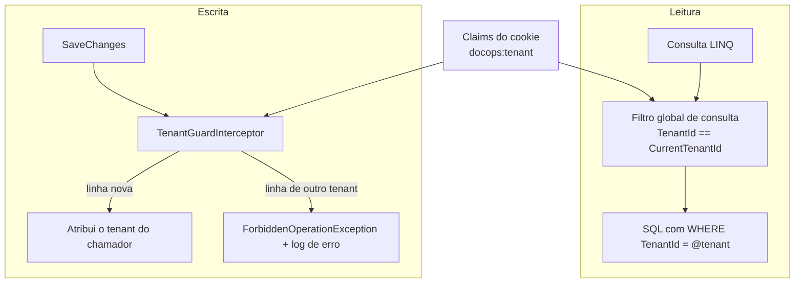
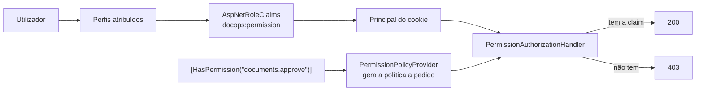
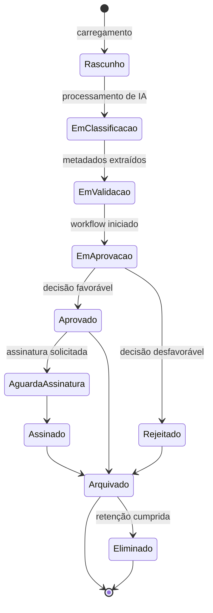
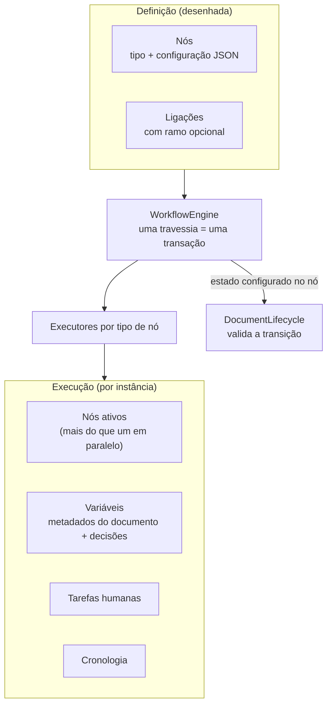
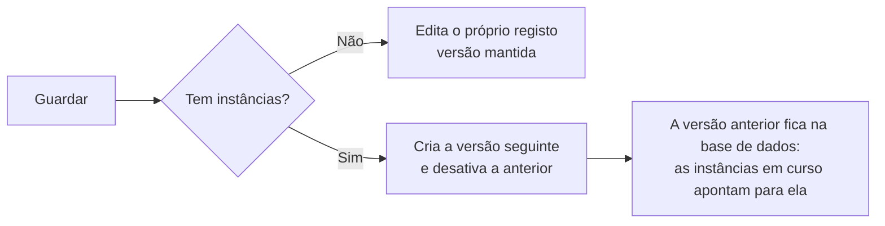
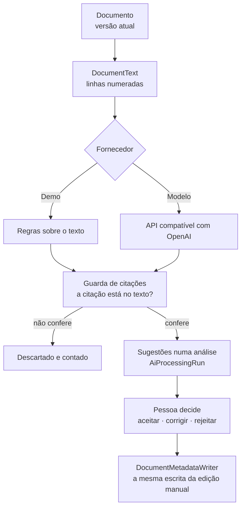

# Arquitetura

## 1. Princípios

1. **Fronteiras explícitas, um único processo.** Os módulos comunicam por interfaces, não por rede.
2. **A base de dados é a fonte de verdade.** A interface apresenta estado; não o define.
3. **Segurança no servidor.** Todas as decisões de autorização são tomadas e revalidadas no backend.
4. **Simplicidade deliberada.** Um padrão só entra quando o problema que resolve já existe no código.
5. **Observável por omissão.** Cada pedido é correlacionável entre logs, *traces* e auditoria.

## 2. Estrutura da solução

```
src/
  Domain/          Entidades, invariantes, catálogo de permissões. Sem dependências de infraestrutura.
  Application/     Contratos (DTO), validação e abstrações (ICurrentUser, ITenantContext, IAuditService).
  Infrastructure/  EF Core, Identity, auditoria, implementação das abstrações. Detalhes substituíveis.
  Api/             Pipeline HTTP, controladores, tratamento de erros, observabilidade.
  Web/             Aplicação React (TypeScript, Vite).
tests/
  UnitTests/        Regras puras: permissões, catálogo de perfis, paginação, validação.
  IntegrationTests/ API real + SQL Server real (Testcontainers).
  e2e/              Playwright: percursos completos no browser.
docs/               Documentação e registos de decisão de arquitetura (ADR).
```

A direção das dependências é sempre para dentro: `Api → Infrastructure → Application → Domain`.
O `Domain` não conhece EF Core, HTTP nem React.

### Uma exceção consciente

`Domain` referencia `Microsoft.Extensions.Identity.Stores` para que `ApplicationUser` derive de
`IdentityUser<Guid>`. A alternativa pura — uma entidade de domínio `User` separada do utilizador de
autenticação — obrigaria a sincronizar dois modelos do mesmo conceito, um custo permanente para um
benefício teórico. Ver [ADR-002](adr/ADR-002-authentication.md).

## 3. Módulos de domínio

| Módulo | Responsabilidade | Fase |
| --- | --- | --- |
| Identity & Access | Autenticação, perfis, permissões, sessão | 1 ✅ |
| Organizations / Tenancy | Organizações, departamentos, adesões | 1 ✅ |
| Audit & Compliance | Registo imutável, retenção, classificação, retenção legal | 1 (base) ✅ |
| Document Management | Documentos, versões, metadados, permissões documentais | 2 ✅ |
| Document Classification | Tipos de documento e campos de metadados | 2 ✅ |
| Workflow Management / Execution | Definições, instâncias, estados, prazos | 3 ✅ (designer visual na 4) |
| Tasks & Approvals | Tarefas humanas, aprovações, delegação, SLA | 3 ✅ |
| AI Intelligence | Classificação, extração, perguntas sobre documentos | 5 ✅ |
| Search | Pesquisa por metadados, texto integral e linguagem natural | 6 ✅ |
| Email / Inbox | Caixa de entrada e processamento de anexos | 6 ✅ |
| Integrations | Adaptadores externos, execução e registo por organização | 6 ✅ |
| External Portal | Submissões de parceiros e o seu acompanhamento | 7 ✅ |
| Electronic Signature | Pedidos e estados de assinatura | 7 ✅ |
| Reporting & Analytics | Indicadores e gráficos a partir de dados reais | 8 |
| Notifications | Notificações e escalonamentos | 3 ✅ |
| Administration | Gestão de utilizadores, perfis, departamentos e definições | 8 |

## 4. Pipeline de pedido

```mermaid
flowchart LR
    R["Pedido"] --> EH["Tratamento de exceções<br/>ProblemDetails"]
    EH --> CID["Correlação<br/>X-Correlation-Id"]
    CID --> SEC["Cabeçalhos de segurança<br/>CSP · nosniff · DENY"]
    SEC --> LOG["Serilog<br/>request logging"]
    LOG --> LOC["Localização<br/>pt-PT · en"]
    LOC --> CORS["CORS"]
    CORS --> ORG["Validação de origem<br/>(CSRF)"]
    ORG --> RL["Rate limiting"]
    RL --> AUTHN["Autenticação por cookie"]
    AUTHN --> AUTHZ["Autorização por permissão"]
    AUTHZ --> VAL["Validação do payload"]
    VAL --> C["Controlador → serviço de aplicação"]
```



Cada camada tem uma responsabilidade única e é testada: os testes de integração verificam os
cabeçalhos de segurança, o bloqueio por origem, o tratamento de erros e as respostas de autenticação.

## 5. Multi-tenancy

O isolamento é aplicado em dois pontos independentes, para que um esquecimento numa consulta não se
transforme numa fuga de dados:



O tenant é lido exclusivamente das *claims* da sessão (`ICurrentUser` → `ITenantContext`). Contextos
sem utilizador autenticado — migrações, semeadura, trabalhos em segundo plano — não aplicam filtro,
o que é seguro porque não existe *endpoint* com dados de organização acessível sem autenticação.

Administradores de plataforma não contornam o filtro implicitamente: o acesso entre organizações
exige `IgnoreQueryFilters()` num serviço dedicado e é auditado.

## 6. Autorização



As permissões residem na base de dados, o que permite a um administrador alterar o que um perfil pode
fazer sem novo *deploy*. A revalidação do *security stamp* a cada 5 minutos faz com que uma permissão
revogada deixe de funcionar sem esperar pelo fim da sessão.

A autorização ao nível do recurso está implementada para documentos em
`DocumentAccessEvaluator`: uma função pura que recebe os factos do documento, os factos do chamador e
as permissões explícitas, e devolve os níveis concedidos **com a razão de cada regra**. É essa
explicação que alimenta o painel de *acesso efetivo* na interface.

Uma separação deliberada: o avaliador responde a *quem pode agir*; `DocumentLifecycle` responde a *o
que pode ser feito no estado atual*. A primeira versão misturava as duas — e tornava impossível
arquivar um documento aprovado, porque o estado "aprovado" retirava o direito de edição que o arquivo
exigia. Um teste de integração apanhou-o.

## 7. Persistência

- **EF Core 10 com SQL Server.** Configuração por *Fluent API* em classes `IEntityTypeConfiguration`.
- **Identificadores UUIDv7** (`Guid.CreateVersion7()`): únicos e sequenciais, o que evita a
  fragmentação de índice típica de GUIDs aleatórios.
- **Concorrência otimista** por coluna `rowversion` nas entidades mutáveis.
- **Soft delete** com filtro global; a eliminação é reversível e o histórico preserva-se.
- **Índices únicos filtrados** (por exemplo, código de departamento único por organização, ignorando
  registos eliminados) e índices compostos orientados às consultas reais.
- **Intercetores** para carimbos temporais, autor da alteração, *soft delete*, isolamento de tenant e
  imutabilidade da auditoria — comportamento transversal fora do código de negócio.
- **Paginação no servidor** e projeções (`Select`) em vez de carregar grafos inteiros.

### Ciclo de vida do documento (Fase 2)



Cada transição é uma regra de domínio no backend e gera um registo de auditoria. Uma alteração de
conteúdo cria sempre uma nova versão; versões anteriores nunca são sobrescritas.

## 8. Auditoria

Um registo de auditoria contém o que aconteceu, quem o fez, quando, em que organização, a partir de
que endereço, com que identificador de correlação e — quando aplicável — o estado antes e depois.

- O ator é resolvido pelo serviço a partir do contexto do pedido, nunca indicado pelo chamador: uma
  ação não pode ser atribuída ao utilizador errado por engano de quem chama.
- A escrita ocorre num contexto próprio, para que um registo de auditoria não seja revertido com a
  transação de negócio que descreve.
- Campos sensíveis (palavras-passe, segredos, chaves) são redigidos antes da serialização.
- `AuditImmutabilityInterceptor` recusa qualquer `UPDATE` ou `DELETE`; a base de dados revoga essas
  permissões ao *login* aplicacional (ver `SECURITY.md`).

## 9. Frontend

- **Estado do servidor** em TanStack Query; a sessão é uma consulta como outra qualquer, o que
  elimina a duplicação entre "estado de autenticação" e "dados do utilizador".
- **Formulários** com React Hook Form e esquemas Zod; as mensagens de erro são chaves de tradução,
  não texto fixo.
- **Erros da API** são convertidos em `ApiError` com `code` estável, que o frontend traduz — o
  servidor não precisa de conhecer o idioma do utilizador para produzir uma mensagem correta.
- **Design system** em *tokens* CSS (cor, espaçamento, tipografia, raio, sombra) com tema claro e
  escuro; os componentes referenciam *tokens* semânticos (`surface`, `ink`, `border`), nunca cores
  diretas.
- **Navegação orientada a dados e a permissões**: uma entrada só existe quando a rota, a API e a
  persistência existem.

## 10. Motor de workflow



O motor percorre os nós até cada ramo ficar parado — à espera de uma pessoa ou de um temporizador — ou
terminado, e só então persiste. Consequências que importam:

- **Consistência**: instância, tarefas, cronologia e estado do documento gravam juntos. Uma falha a
  meio da travessia deixa a instância exatamente onde estava.
- **Falhar em vez de saltar**: um tipo de nó sem executor, uma ligação em falta ou uma transição de
  documento ilegal param a instância com o motivo registado na cronologia. Um processo que se
  "desenrasca" sozinho é pior do que um processo que para e diz porquê.
- **Espera sem custo**: uma instância parada não consome nada além de uma data numa coluna; o worker
  retoma-a quando a data chega.
- **Separação de responsabilidades**: `DocumentAccessEvaluator` diz quem pode agir,
  `DocumentLifecycle` diz o que pode ser feito ao documento agora, e o motor diz para onde o processo
  segue. Nenhum dos três decide pelos outros.

### O desenhador e o versionamento das definições

O desenhador escreve exatamente o mesmo modelo que o motor lê: nós com tipo e configuração em JSON,
ligações com ramo opcional. Não existe um formato de desenho separado do formato de execução.

A regra que decide o que acontece ao guardar é uma só: **uma instância em curso tem de continuar a
resolver os nós com que arrancou.**



Consequências que moldaram o desenho:

- O índice único das definições é `(TenantId, Code, Version)`, e não `(TenantId, Code)`. Várias
  versões do mesmo processo coexistem por construção, não por acidente.
- Guardar marca sempre o registo da definição como alterado. Nós e ligações vivem em tabelas
  próprias: sem isto, uma gravação feita a partir de uma leitura desatualizada reescreveria o grafo
  sem que o `rowversion` chegasse a ser verificado. Foi um teste de integração que revelou a falha.
- Uma cópia nasce sempre inativa e na versão 1: duplicar um processo ativo não pode pôr um segundo
  processo a arrancar sozinho.
- Eliminar é recusado enquanto houver execuções em curso, e é reversível quando é aceite.

A validação está dividida por propósito, não duplicada. O desenhador assinala no momento o que é
óbvio ao desenhar (um passo sem saída, um passo que nenhuma ligação alcança, uma condição sem os dois
ramos) para dar resposta imediata; o servidor é quem decide se um processo pode ser ativado, e é a
sua validação que aparece na lista de problemas. Um processo por acabar **pode** ser guardado: estar
meio desenhado é um estado normal de trabalho.

## 10.1 Inteligência documental



Três invariantes sustentam esta fase, e estão no código, não na interface.

**A origem viaja com o resultado.** `AiSource` (`Demo` ou `Model`) faz parte de cada contrato que
carrega saída de IA. Nenhum cliente consegue mostrar uma resposta de demonstração como sendo de um
modelo, porque não lhe chega nada sem essa etiqueta.

**Uma citação é um sítio onde ir ver, não uma afirmação.** `DocumentText` numera as linhas do
documento — a mesma numeração que o endpoint `/text` serve à interface — e `Verifies` confirma que
as palavras citadas estão mesmo na linha indicada. O `AiDocumentAnalyzer` aplica essa guarda a tudo
o que um fornecedor devolve, seja ele qual for. Ao fornecedor de modelo exige-se mais: o valor tem
de se poder reler a partir da citação, porque um modelo pode citar bem e inventar o número ao lado.

**Nada chega ao documento sem decisão.** A análise é uma entidade com estado (`AiProcessingRun`) e
cada sugestão tem a sua decisão, o seu autor e o seu momento. Aplicar escreve pelo
`DocumentMetadataWriter`, o mesmo componente que a edição manual usa: a IA não tem porta lateral,
e por isso herda a tipagem, a validação e a regra de campos obrigatórios sem as duplicar.

O tipo **«Por classificar»** existe para que o resto seja possível: sem campos obrigatórios, um
ficheiro pode ser guardado antes de alguém o ler. Reclassificar nunca baixa a sensibilidade — o
documento fica com a classificação mais restritiva entre a sua e a do tipo novo — e a política de
retenção acompanha o tipo apenas quando era a do tipo anterior.

Nos workflows, um passo de IA **não chama o fornecedor**: cria uma análise em fila e estaciona a
instância. Chamar um modelo dentro da travessia manteria uma transação de base de dados aberta
durante toda a resposta. O worker processa a fila fora de qualquer transação e retoma a instância,
que na segunda visita ao nó lê o resultado para variáveis `ai.*`.

## 10.2 Pesquisa

A pesquisa é **uma consulta**. O predicado de autorização, os filtros, a correspondência de texto, o
peso de relevância e a página resolvem-se todos no SQL Server, dentro do conjunto de documentos que
quem pergunta pode ver. Daí que o total apresentado seja o total que essa pessoa pode conhecer, e
não o que existe: contar primeiro e filtrar depois transformaria a contagem numa fuga.

Os filtros vivem num sítio só — `DocumentFilters` —, partilhado entre a lista de documentos e o ecrã
de pesquisa, para que um filtro não signifique uma coisa num ecrã e outra no outro. Dois deles são
**derivados** e não guardados: o estado do processo lê-se da instância de workflow mais recente do
documento, e o estado de aprovação lê-se das tarefas de decisão levantadas para ele. Uma cópia no
documento seria mais uma coisa capaz de discordar dos factos.

O texto integral depende de um componente **opcional** do SQL Server. A aplicação não o pressupõe:

- `FullTextAvailability` pergunta uma vez ao servidor se o componente existe e se os índices da
  migração existem, e guarda a resposta.
- Com índice, `CONTAINS` responde sobre título, referência, resumo, texto extraído e valores de
  metadados; sem índice, as mesmas colunas são comparadas por subcadeia.
- Cada resposta declara qual dos dois caminhos correu, e a interface mostra-o. Uma pesquisa
  degradada em silêncio pareceria uma pesquisa que encontrou menos.

O que a interface realça num excerto vem do servidor, que encontrou as palavras no texto guardado —
a mesma disciplina das citações da Fase 5: o ecrã não volta a procurar, e por isso não pode realçar
algo que o documento não diga.

As perguntas em linguagem natural passam por `IAiSearchService`, que devolve **filtros** e nunca
resultados. O leitor de demonstração é uma tabela de expressões mais uma consulta ao catálogo da
própria organização; o leitor por modelo recebe a pergunta e os nomes do catálogo, e cada nome que
devolve é reconferido contra esse catálogo. Um leitor capaz de alcançar os dados poderia ser
convencido a alcançar dados que quem pergunta não pode ver. Detalhes e alternativas rejeitadas em
[ADR-005](adr/ADR-005-search-architecture.md).

## 10.3 Caixa de entrada

O correio entra por um adaptador e sai como documento pelos serviços que já existiam.

`IMailConnector` tem a forma do Microsoft Graph de propósito — listar mensagens de uma caixa, depois
buscar o conteúdo de **um** anexo por identificador. Daí decorre uma escolha que parece pequena e não
é: os bytes de um anexo **não** são copiados na sincronização, só quando alguém decide que o ficheiro
vale a pena. Copiar tudo encheria o repositório com os anexos que ninguém quis, e obrigaria a uma
forma de armazenamento que o Graph não tem.

A mensagem é **prova**, não documento. O corpo e a lista de anexos ficam como o servidor de correio
os entregou; processá-la *produz* documentos a partir dela e regista a ligação dos dois lados, para
que meses depois ainda seja possível responder a «de onde veio esta fatura». Por isso a mensagem
também não desaparece com o documento que produziu: a chave estrangeira é `NoAction` e o filtro da
mensagem é só o da organização, não o do documento.

Nada aqui escreve no repositório por atalho. Um anexo guardado como documento é criado pelo
`IDocumentService`; um processo iniciado a partir de uma mensagem é iniciado pelo `IWorkflowService`.
Cada um aplica a sua própria permissão por cima da permissão de processar a caixa — guardar um anexo
exige também `documents.create`, e iniciar um processo exige `workflows.start`.

O ciclo de vida da mensagem é deliberadamente curto: por ler, lida, processada, arquivada.
`EmailLifecycle` diz o que o estado permite, tal como `DocumentLifecycle` faz para documentos, e o
que a interface esconde é conveniência — o servidor recusa na mesma.

Detalhes e alternativas rejeitadas em [ADR-007](adr/ADR-007-external-connectors.md).

## 10.4 Centro de integrações

`IIntegrationAdapter` é o `IMailConnector` generalizado: um adaptador recebe um contexto com a
organização e devolve um resultado com o que fez, quantos registos tocou, que estado deixa a
integração e as linhas que quer ver no registo. Seis estão escritos — correio, ERP, CRM, assinatura
eletrónica, webhooks e importação de ficheiros.

**Quem escreve o estado é o executor, não o adaptador.** `IntegrationExecutor` recebe o resultado e
é ele que grava `Status`, `RecordsProcessed`, `ErrorCount` e `LastRunAtUtc`, e que converte uma
exceção do adaptador em estado «Com falha» com a mensagem — nunca a pilha. Se cada adaptador
escrevesse o seu próprio estado, o cartão passaria a ser a opinião do adaptador sobre si mesmo em
vez do registo do que aconteceu.

**Dois caminhos de execução, um executor.** `IntegrationService` corre no pedido do utilizador e usa
o `DbContext` filtrado pela organização, pelo que só alcança a integração de quem a pediu;
`IntegrationRunner` corre no worker, sem utilizador, e passa por `IgnoreQueryFilters` para varrer
todas as organizações — a mesma exceção consciente que o resto do trabalho periódico já tinha. Os
dois terminam no mesmo `IntegrationExecutor`, para que não haja duas formas de uma integração correr.

**O nó de workflow não chama nada dentro da transação do motor.** Uma travessia do grafo é uma
transação; uma chamada externa lá dentro manteria-a aberta à espera da rede.
`IntegrationNodeExecutor` enfileira um `IntegrationRunRequest` e devolve `Wait()`; o processador da
fila corre o pedido e retoma a instância. É a mesma forma dos nós de IA — de propósito.

**O registo de uma integração não é auditoria.** `IntegrationLog` é operacional: pode ser truncado,
não faz parte do trilho imutável. O que vai para a auditoria é o facto de alguém ter executado ou
reconfigurado a integração, não cada linha do que o adaptador relatou.

Detalhes e alternativas rejeitadas em [ADR-007](adr/ADR-007-external-connectors.md).

## 10.5 Portal externo

A primeira vez que o produto deixa entrar alguém de fora da organização, e a única parte da
aplicação cuja audiência não é um colaborador.

**Não tem autorização própria.** `PortalService` filtra com
`DocumentAccessResolver.BuildVisibilityPredicate` — o mesmo predicado da listagem interna, que já
concede a um utilizador externo apenas o que ele possui ou lhe foi explicitamente concedido, nunca
por rótulo de sensibilidade. Dois conjuntos de regras sobre os mesmos documentos acabariam por
divergir, e quando divergem é o mais permissivo que prevalece.

**Os contratos são tipos próprios.** `PortalSubmissionDto` não é o `DocumentListItemDto` com menos
campos: é um tipo diferente, projetado à mão. A repetição é o preço; o que se compra é que um campo
acrescentado do lado interno não atravesse sozinho no dia em que alguém o acrescenta.

**A cronologia é construída por seleção, não por exclusão.** O fornecedor vê os eventos
`information.requested` e `information.provided`, nomeados um a um. Uma lista construída como «tudo
menos o que é interno» deixaria entrar, por omissão, o tipo de evento que a próxima fase
acrescentar.

**A separação corre nos dois sentidos**, e é navegação por cima de autorização: `RequirePortal`
reencaminha quem está do lado errado, e o servidor recusa de qualquer forma, porque nenhum perfil
interno detém `portal.access` e nenhum externo detém o que a aplicação interna exige.

Detalhes e alternativas rejeitadas em [ADR-008](adr/ADR-008-external-portal.md).

## 10.6 Assinatura eletrónica

**Demonstração de portefólio, sem validade legal.** Não é uma assinatura qualificada nem avançada: o
que existe é um registo de que uma pessoa concordou, num momento, com um conteúdo identificado por
resumo.

**A ligação ao conteúdo é o que torna o registo útil.** O pedido fixa `DocumentVersionId` e copia o
`ContentHash` dessa versão. Assinar compara; se divergir, recusa. Uma versão posterior não reescreve
o registo — `ContentStillMatches` passa a falso, que é a única das três leituras possíveis que é
verdadeira (as outras seriam apagar a prova, ou re-apontá-la em silêncio para conteúdo que ninguém
consentiu).

**Assinar não é editar.** A transição do documento para «assinado» é aplicada diretamente, validada
pelo `DocumentLifecycle` e não pelos direitos de quem age — exatamente como o motor de workflow
aplica estados. Exigir `Edit` obrigaria a distribuir direitos de edição só para recolher assinaturas.

**Assinar é pessoal.** `SignatureLifecycle.CanSign` compara o utilizador com o signatário nomeado, e
mais nada: nenhuma permissão contorna isso.

Detalhes e alternativas rejeitadas em [ADR-009](adr/ADR-009-electronic-signature.md).

## 11. Processamento em segundo plano

O projeto `src/Worker` corre num processo separado da API: retoma de temporizadores, escalonamento
de prazos, fila de processamento de IA e varrimento periódico das integrações. Nenhum pedido de
utilizador espera por trabalho periódico, e o worker vê todas as organizações — uma exceção
deliberada, confinada a trabalho que nenhum pedido HTTP alcança.

As integrações não correm a cada ciclo: `IntegrationEveryNCycles` espaça-as, porque sincronizar
correio e reconciliar catálogos não tem a urgência de um prazo a expirar.

A verificação de retenção junta-se a estes trabalhos na fase respetiva.

## 12. Preparação para a nuvem

| Abstração | Implementação local | Implementação em Azure |
| --- | --- | --- |
| `IFileStorage` | Sistema de ficheiros | Azure Blob Storage |
| Base de dados | SQL Server em container | Azure SQL |
| `IAi*Service` | Fornecedor de demonstração determinístico | Azure OpenAI |
| `IMailConnector` | Conetor de demonstração, sem credenciais | Microsoft Graph |
| `IIntegrationAdapter` | Adaptadores locais, sem credenciais | APIs de ERP, CRM e assinatura |
| Autenticação | Cookie + Identity | OpenID Connect / Microsoft Entra ID |
| Telemetria | Consola + OTLP | Application Insights |

Nenhuma conta de nuvem é necessária para desenvolver, testar ou demonstrar o projeto.
