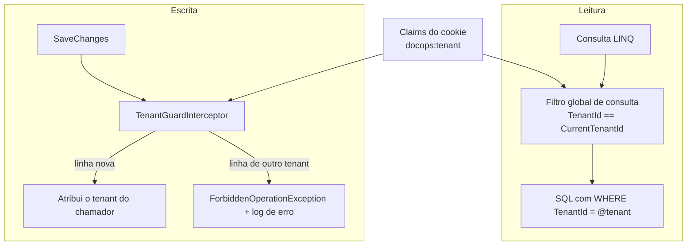
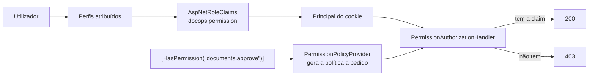
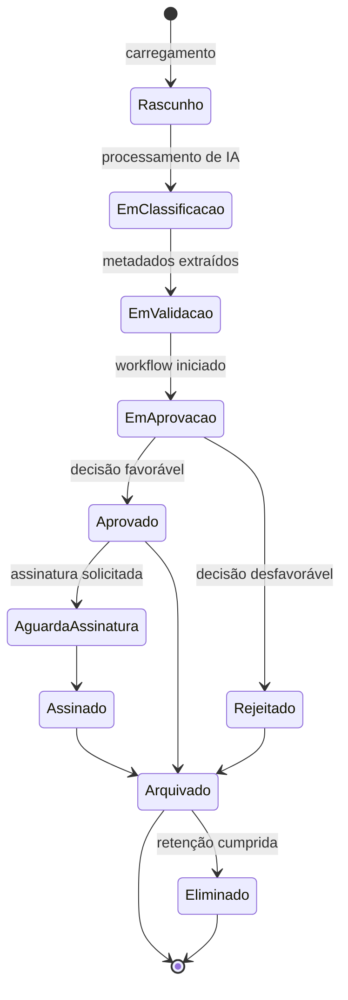
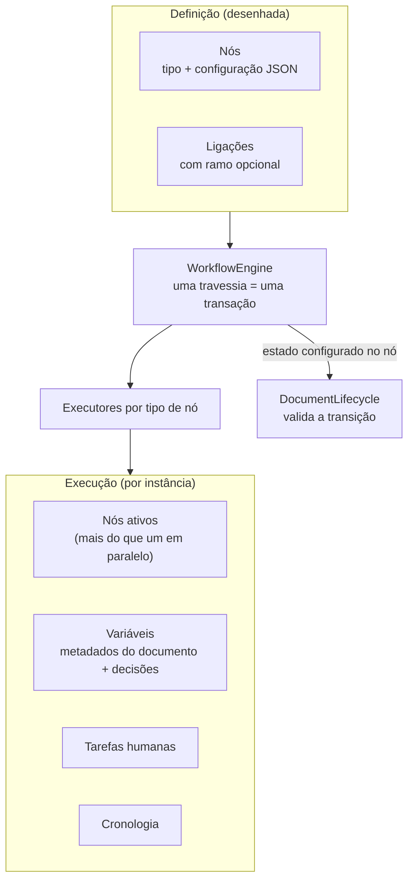

# Arquitetura

## 1. Princípios

1. **Fronteiras explícitas, um único processo.** Os módulos comunicam por interfaces, não por rede.
2. **A base de dados é a fonte de verdade.** A interface apresenta estado; não o define.
3. **Segurança no servidor.** Todas as decisões de autorização são tomadas e revalidadas no backend.
4. **Simplicidade deliberada.** Um padrão só entra quando o problema que resolve já existe no código.
5. **Observável por omissão.** Cada pedido é correlacionável entre logs, *traces* e auditoria.

## 2. Estrutura da solução

```
src/
  Domain/          Entidades, invariantes, catálogo de permissões. Sem dependências de infraestrutura.
  Application/     Contratos (DTO), validação e abstrações (ICurrentUser, ITenantContext, IAuditService).
  Infrastructure/  EF Core, Identity, auditoria, implementação das abstrações. Detalhes substituíveis.
  Api/             Pipeline HTTP, controladores, tratamento de erros, observabilidade.
  Web/             Aplicação React (TypeScript, Vite).
tests/
  UnitTests/        Regras puras: permissões, catálogo de perfis, paginação, validação.
  IntegrationTests/ API real + SQL Server real (Testcontainers).
  e2e/              Playwright: percursos completos no browser.
docs/               Documentação e registos de decisão de arquitetura (ADR).
```

A direção das dependências é sempre para dentro: `Api → Infrastructure → Application → Domain`.
O `Domain` não conhece EF Core, HTTP nem React.

### Uma exceção consciente

`Domain` referencia `Microsoft.Extensions.Identity.Stores` para que `ApplicationUser` derive de
`IdentityUser<Guid>`. A alternativa pura — uma entidade de domínio `User` separada do utilizador de
autenticação — obrigaria a sincronizar dois modelos do mesmo conceito, um custo permanente para um
benefício teórico. Ver [ADR-002](adr/ADR-002-authentication.md).

## 3. Módulos de domínio

| Módulo | Responsabilidade | Fase |
| --- | --- | --- |
| Identity & Access | Autenticação, perfis, permissões, sessão | 1 ✅ |
| Organizations / Tenancy | Organizações, departamentos, adesões | 1 ✅ |
| Audit & Compliance | Registo imutável, retenção, classificação, retenção legal | 1 (base) ✅ |
| Document Management | Documentos, versões, metadados, permissões documentais | 2 ✅ |
| Document Classification | Tipos de documento e campos de metadados | 2 ✅ |
| Workflow Management / Execution | Definições, instâncias, estados, prazos | 3 ✅ (designer visual na 4) |
| Tasks & Approvals | Tarefas humanas, aprovações, delegação, SLA | 3 ✅ |
| AI Intelligence | Classificação, extração, perguntas sobre documentos | 5 |
| Search | Pesquisa por metadados, texto integral e linguagem natural | 6 |
| Email / Inbox | Caixa de entrada e processamento de anexos | 6 |
| Integrations | Adaptadores externos e registo de sincronização | 6 |
| Electronic Signature | Pedidos e estados de assinatura | 7 |
| Reporting & Analytics | Indicadores e gráficos a partir de dados reais | 8 |
| Notifications | Notificações e escalonamentos | 3 ✅ |
| Administration | Gestão de utilizadores, perfis, departamentos e definições | 8 |

## 4. Pipeline de pedido


Cada camada tem uma responsabilidade única e é testada: os testes de integração verificam os
cabeçalhos de segurança, o bloqueio por origem, o tratamento de erros e as respostas de autenticação.

## 5. Multi-tenancy

O isolamento é aplicado em dois pontos independentes, para que um esquecimento numa consulta não se
transforme numa fuga de dados:



O tenant é lido exclusivamente das *claims* da sessão (`ICurrentUser` → `ITenantContext`). Contextos
sem utilizador autenticado — migrações, semeadura, trabalhos em segundo plano — não aplicam filtro,
o que é seguro porque não existe *endpoint* com dados de organização acessível sem autenticação.

Administradores de plataforma não contornam o filtro implicitamente: o acesso entre organizações
exige `IgnoreQueryFilters()` num serviço dedicado e é auditado.

## 6. Autorização



As permissões residem na base de dados, o que permite a um administrador alterar o que um perfil pode
fazer sem novo *deploy*. A revalidação do *security stamp* a cada 5 minutos faz com que uma permissão
revogada deixe de funcionar sem esperar pelo fim da sessão.

A autorização ao nível do recurso está implementada para documentos em
`DocumentAccessEvaluator`: uma função pura que recebe os factos do documento, os factos do chamador e
as permissões explícitas, e devolve os níveis concedidos **com a razão de cada regra**. É essa
explicação que alimenta o painel de *acesso efetivo* na interface.

Uma separação deliberada: o avaliador responde a *quem pode agir*; `DocumentLifecycle` responde a *o
que pode ser feito no estado atual*. A primeira versão misturava as duas — e tornava impossível
arquivar um documento aprovado, porque o estado "aprovado" retirava o direito de edição que o arquivo
exigia. Um teste de integração apanhou-o.

## 7. Persistência

- **EF Core 10 com SQL Server.** Configuração por *Fluent API* em classes `IEntityTypeConfiguration`.
- **Identificadores UUIDv7** (`Guid.CreateVersion7()`): únicos e sequenciais, o que evita a
  fragmentação de índice típica de GUIDs aleatórios.
- **Concorrência otimista** por coluna `rowversion` nas entidades mutáveis.
- **Soft delete** com filtro global; a eliminação é reversível e o histórico preserva-se.
- **Índices únicos filtrados** (por exemplo, código de departamento único por organização, ignorando
  registos eliminados) e índices compostos orientados às consultas reais.
- **Intercetores** para carimbos temporais, autor da alteração, *soft delete*, isolamento de tenant e
  imutabilidade da auditoria — comportamento transversal fora do código de negócio.
- **Paginação no servidor** e projeções (`Select`) em vez de carregar grafos inteiros.

### Ciclo de vida do documento (Fase 2)



Cada transição é uma regra de domínio no backend e gera um registo de auditoria. Uma alteração de
conteúdo cria sempre uma nova versão; versões anteriores nunca são sobrescritas.

## 8. Auditoria

Um registo de auditoria contém o que aconteceu, quem o fez, quando, em que organização, a partir de
que endereço, com que identificador de correlação e — quando aplicável — o estado antes e depois.

- O ator é resolvido pelo serviço a partir do contexto do pedido, nunca indicado pelo chamador: uma
  ação não pode ser atribuída ao utilizador errado por engano de quem chama.
- A escrita ocorre num contexto próprio, para que um registo de auditoria não seja revertido com a
  transação de negócio que descreve.
- Campos sensíveis (palavras-passe, segredos, chaves) são redigidos antes da serialização.
- `AuditImmutabilityInterceptor` recusa qualquer `UPDATE` ou `DELETE`; a base de dados revoga essas
  permissões ao *login* aplicacional (ver `SECURITY.md`).

## 9. Frontend

- **Estado do servidor** em TanStack Query; a sessão é uma consulta como outra qualquer, o que
  elimina a duplicação entre "estado de autenticação" e "dados do utilizador".
- **Formulários** com React Hook Form e esquemas Zod; as mensagens de erro são chaves de tradução,
  não texto fixo.
- **Erros da API** são convertidos em `ApiError` com `code` estável, que o frontend traduz — o
  servidor não precisa de conhecer o idioma do utilizador para produzir uma mensagem correta.
- **Design system** em *tokens* CSS (cor, espaçamento, tipografia, raio, sombra) com tema claro e
  escuro; os componentes referenciam *tokens* semânticos (`surface`, `ink`, `border`), nunca cores
  diretas.
- **Navegação orientada a dados e a permissões**: uma entrada só existe quando a rota, a API e a
  persistência existem.

## 10. Motor de workflow



O motor percorre os nós até cada ramo ficar parado — à espera de uma pessoa ou de um temporizador — ou
terminado, e só então persiste. Consequências que importam:

- **Consistência**: instância, tarefas, cronologia e estado do documento gravam juntos. Uma falha a
  meio da travessia deixa a instância exatamente onde estava.
- **Falhar em vez de saltar**: um tipo de nó sem executor, uma ligação em falta ou uma transição de
  documento ilegal param a instância com o motivo registado na cronologia. Um processo que se
  "desenrasca" sozinho é pior do que um processo que para e diz porquê.
- **Espera sem custo**: uma instância parada não consome nada além de uma data numa coluna; o worker
  retoma-a quando a data chega.
- **Separação de responsabilidades**: `DocumentAccessEvaluator` diz quem pode agir,
  `DocumentLifecycle` diz o que pode ser feito ao documento agora, e o motor diz para onde o processo
  segue. Nenhum dos três decide pelos outros.

## 11. Processamento em segundo plano

O projeto `src/Worker` corre num processo separado da API: retoma de temporizadores e escalonamento
de prazos. Nenhum pedido de utilizador espera por trabalho periódico, e o worker vê todas as
organizações — uma exceção deliberada, confinada a trabalho que nenhum pedido HTTP alcança.

Verificação de retenção e fila de processamento de IA juntam-se a estes trabalhos nas fases
respetivas.

## 12. Preparação para a nuvem

| Abstração | Implementação local | Implementação em Azure |
| --- | --- | --- |
| `IFileStorage` | Sistema de ficheiros | Azure Blob Storage |
| Base de dados | SQL Server em container | Azure SQL |
| `IAi*Service` | Fornecedor de demonstração determinístico | Azure OpenAI |
| Autenticação | Cookie + Identity | OpenID Connect / Microsoft Entra ID |
| Telemetria | Consola + OTLP | Application Insights |

Nenhuma conta de nuvem é necessária para desenvolver, testar ou demonstrar o projeto.
